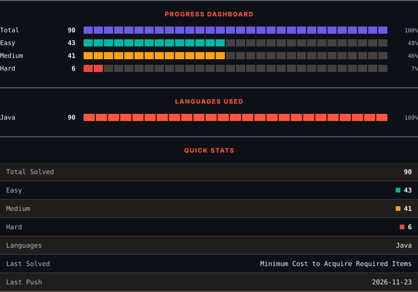
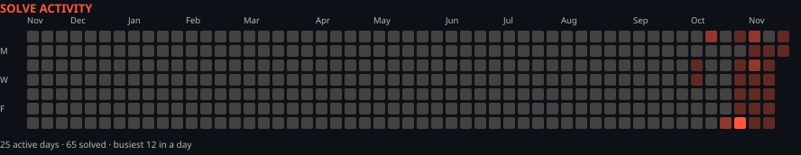

<h1>LeetCode Solutions</h1>

<em>Automatically synced with every accepted submission</em>

   

<picture>
  <source media="(prefers-color-scheme: dark)" srcset=".leetsync/stats-dark.svg">
  <source media="(prefers-color-scheme: light)" srcset=".leetsync/stats-light.svg">
  
</picture>

<picture>
  <source media="(prefers-color-scheme: dark)" srcset=".leetsync/calendar-dark.svg">
  <source media="(prefers-color-scheme: light)" srcset=".leetsync/calendar-light.svg">
  
</picture>

---

### ALL SOLUTIONS

**Latest 10**

| # | Problem | Difficulty | Language | Date |
|:---:|:--------|:----------:|:--------:|:----:|
| 2469 | [Convert the Temperature](problems/2469-Convert-the-Temperature) | 🟩 Easy | `Java` | 2026-11-23 |
| 2413 | [Smallest Even Multiple](problems/2413-Smallest-Even-Multiple) | 🟩 Easy | `Java` | 2026-11-23 |
| 2235 | [Add Two Integers](problems/2235-Add-Two-Integers) | 🟩 Easy | `Java` | 2026-11-23 |
| 2185 | [Counting Words With a Given Prefix](problems/2185-Counting-Words-With-a-Given-Prefix) | 🟩 Easy | `Java` | 2026-11-23 |
| 2169 | [Count Operations to Obtain Zero](problems/2169-Count-Operations-to-Obtain-Zero) | 🟩 Easy | `Java` | 2026-11-23 |
| 2027 | [Minimum Moves to Convert String](problems/2027-Minimum-Moves-to-Convert-String) | 🟩 Easy | `Java` | 2026-11-23 |
| 2011 | [Final Value of Variable After Performing Operations](problems/2011-Final-Value-of-Variable-After-Performing-Operations) | 🟩 Easy | `Java` | 2026-11-23 |
| 1832 | [Check if the Sentence Is Pangram](problems/1832-Check-if-the-Sentence-Is-Pangram) | 🟩 Easy | `Java` | 2026-11-23 |
| 2124 | [Check if All A's Appears Before All B's](problems/2124-Check-if-All-As-Appears-Before-All-Bs) | 🟩 Easy | `Java` | 2026-11-22 |
| 771 | [Jewels and Stones](problems/0771-Jewels-and-Stones) | 🟩 Easy | `Java` | 2026-11-22 |

<strong>🟩 Easy</strong> — 43 solved

| # | Problem | Difficulty | Language | Date |
|:---:|:--------|:----------:|:--------:|:----:|
| 20 | [Valid Parentheses](problems/0020-Valid-Parentheses) | 🟩 Easy | `Java` | 2026-11-16 |
| 21 | [Merge Two Sorted Lists](problems/0021-Merge-Two-Sorted-Lists) | 🟩 Easy | `Java` | 2026-10-31 |
| 83 | [Remove Duplicates from Sorted List](problems/0083-Remove-Duplicates-from-Sorted-List) | 🟩 Easy | `Java` | 2026-10-31 |
| 141 | [Linked List Cycle](problems/0141-Linked-List-Cycle) | 🟩 Easy | `Java` | 2026-10-31 |
| 160 | [Intersection of Two Linked Lists](problems/0160-Intersection-of-Two-Linked-Lists) | 🟩 Easy | `Java` | 2026-10-30 |
| 203 | [Remove Linked List Elements](problems/0203-Remove-Linked-List-Elements) | 🟩 Easy | `Java` | 2026-11-01 |
| 206 | [Reverse Linked List](problems/0206-Reverse-Linked-List) | 🟩 Easy | `Java` | 2026-10-31 |
| 217 | [Contains Duplicate](problems/0217-Contains-Duplicate) | 🟩 Easy | `Java` | 2026-11-05 |
| 234 | [Palindrome Linked List](problems/0234-Palindrome-Linked-List) | 🟩 Easy | `Java` | 2026-10-30 |
| 387 | [First Unique Character in a String](problems/0387-First-Unique-Character-in-a-String) | 🟩 Easy | `Java` | 2026-10-24 |
| 414 | [Third Maximum Number](problems/0414-Third-Maximum-Number) | 🟩 Easy | `Java` | 2026-11-05 |
| 463 | [Island Perimeter](problems/0463-Island-Perimeter) | 🟩 Easy | `Java` | 2026-11-22 |
| 496 | [Next Greater Element I](problems/0496-Next-Greater-Element-I) | 🟩 Easy | `Java` | 2026-11-17 |
| 509 | [Fibonacci Number](problems/0509-Fibonacci-Number) | 🟩 Easy | `Java` | 2026-11-22 |
| 520 | [Detect Capital](problems/0520-Detect-Capital) | 🟩 Easy | `Java` | 2026-11-22 |
| 682 | [Baseball Game](problems/0682-Baseball-Game) | 🟩 Easy | `Java` | 2026-11-15 |
| 728 | [Self Dividing Numbers](problems/0728-Self-Dividing-Numbers) | 🟩 Easy | `Java` | 2026-11-22 |
| 771 | [Jewels and Stones](problems/0771-Jewels-and-Stones) | 🟩 Easy | `Java` | 2026-11-22 |
| 876 | [Middle of the Linked List](problems/0876-Middle-of-the-Linked-List) | 🟩 Easy | `Java` | 2026-10-31 |
| 1047 | [Remove All Adjacent Duplicates In String](problems/1047-Remove-All-Adjacent-Duplicates-In-String) | 🟩 Easy | `Java` | 2026-11-17 |
| 1385 | [Find the Distance Value Between Two Arrays](problems/1385-Find-the-Distance-Value-Between-Two-Arrays) | 🟩 Easy | `Java` | 2026-11-05 |
| 1431 | [Kids With the Greatest Number of Candies](problems/1431-Kids-With-the-Greatest-Number-of-Candies) | 🟩 Easy | `Java` | 2026-10-24 |
| 1464 | [Maximum Product of Two Elements in an Array](problems/1464-Maximum-Product-of-Two-Elements-in-an-Array) | 🟩 Easy | `Java` | 2026-11-03 |
| 1470 | [Shuffle the Array](problems/1470-Shuffle-the-Array) | 🟩 Easy | `Java` | 2026-11-03 |
| 1480 | [Running Sum of 1d Array](problems/1480-Running-Sum-of-1d-Array) | 🟩 Easy | `Java` | 2026-11-03 |
| 1512 | [Number of Good Pairs](problems/1512-Number-of-Good-Pairs) | 🟩 Easy | `Java` | 2026-11-03 |
| 1832 | [Check if the Sentence Is Pangram](problems/1832-Check-if-the-Sentence-Is-Pangram) | 🟩 Easy | `Java` | 2026-11-23 |
| 1876 | [Substrings of Size Three with Distinct Characters](problems/1876-Substrings-of-Size-Three-with-Distinct-Characters) | 🟩 Easy | `Java` | 2026-10-07 |
| 1929 | [Concatenation of Array](problems/1929-Concatenation-of-Array) | 🟩 Easy | `Java` | 2026-11-03 |
| 2011 | [Final Value of Variable After Performing Operations](problems/2011-Final-Value-of-Variable-After-Performing-Operations) | 🟩 Easy | `Java` | 2026-11-23 |
| 2027 | [Minimum Moves to Convert String](problems/2027-Minimum-Moves-to-Convert-String) | 🟩 Easy | `Java` | 2026-11-23 |
| 2124 | [Check if All A's Appears Before All B's](problems/2124-Check-if-All-As-Appears-Before-All-Bs) | 🟩 Easy | `Java` | 2026-11-22 |
| 2169 | [Count Operations to Obtain Zero](problems/2169-Count-Operations-to-Obtain-Zero) | 🟩 Easy | `Java` | 2026-11-23 |
| 2185 | [Counting Words With a Given Prefix](problems/2185-Counting-Words-With-a-Given-Prefix) | 🟩 Easy | `Java` | 2026-11-23 |
| 2235 | [Add Two Integers](problems/2235-Add-Two-Integers) | 🟩 Easy | `Java` | 2026-11-23 |
| 2243 | [Calculate Digit Sum of a String](problems/2243-Calculate-Digit-Sum-of-a-String) | 🟩 Easy | `Java` | 2026-11-16 |
| 2351 | [First Letter to Appear Twice](problems/2351-First-Letter-to-Appear-Twice) | 🟩 Easy | `Java` | 2026-10-24 |
| 2413 | [Smallest Even Multiple](problems/2413-Smallest-Even-Multiple) | 🟩 Easy | `Java` | 2026-11-23 |
| 2469 | [Convert the Temperature](problems/2469-Convert-the-Temperature) | 🟩 Easy | `Java` | 2026-11-23 |
| 3090 | [Maximum Length Substring With Two Occurrences](problems/3090-Maximum-Length-Substring-With-Two-Occurrences) | 🟩 Easy | `Java` | 2026-10-11 |
| 3105 | [Longest Strictly Increasing or Strictly Decreasing Subarray](problems/3105-Longest-Strictly-Increasing-or-Strictly-Decreasing-Subarray) | 🟩 Easy | `Java` | 2026-11-12 |
| 3364 | [Minimum Positive Sum Subarray ](problems/3364-Minimum-Positive-Sum-Subarray) | 🟩 Easy | `Java` | 2026-11-14 |
| 3736 | [Minimum Moves to Equal Array Elements III](problems/3736-Minimum-Moves-to-Equal-Array-Elements-III) | 🟩 Easy | `Java` | 2026-11-03 |

<strong>🟧 Medium</strong> — 41 solved

| # | Problem | Difficulty | Language | Date |
|:---:|:--------|:----------:|:--------:|:----:|
| 2 | [Add Two Numbers](problems/0002-Add-Two-Numbers) | 🟧 Medium | `Java` | 2026-10-31 |
| 3 | [Longest Substring Without Repeating Characters](problems/0003-Longest-Substring-Without-Repeating-Characters) | 🟧 Medium | `Java` | 2026-10-11 |
| 19 | [Remove Nth Node From End of List](problems/0019-Remove-Nth-Node-From-End-of-List) | 🟧 Medium | `Java` | 2026-10-30 |
| 24 | [Swap Nodes in Pairs](problems/0024-Swap-Nodes-in-Pairs) | 🟧 Medium | `Java` | 2026-10-31 |
| 34 | [Find First and Last Position of Element in Sorted Array](problems/0034-Find-First-and-Last-Position-of-Element-in-Sorted-Array) | 🟧 Medium | `Java` | 2026-10-25 |
| 53 | [Maximum Subarray](problems/0053-Maximum-Subarray) | 🟧 Medium | `Java` | 2026-11-15 |
| 56 | [Merge Intervals](problems/0056-Merge-Intervals) | 🟧 Medium | `Java` | 2026-10-28 |
| 57 | [Insert Interval](problems/0057-Insert-Interval) | 🟧 Medium | `Java` | 2026-10-29 |
| 74 | [Search a 2D Matrix](problems/0074-Search-a-2D-Matrix) | 🟧 Medium | `Java` | 2026-10-25 |
| 82 | [Remove Duplicates from Sorted List II](problems/0082-Remove-Duplicates-from-Sorted-List-II) | 🟧 Medium | `Java` | 2026-11-01 |
| 92 | [Reverse Linked List II](problems/0092-Reverse-Linked-List-II) | 🟧 Medium | `Java` | 2026-11-01 |
| 142 | [Linked List Cycle II](problems/0142-Linked-List-Cycle-II) | 🟧 Medium | `Java` | 2026-10-31 |
| 143 | [Reorder List](problems/0143-Reorder-List) | 🟧 Medium | `Java` | 2026-10-31 |
| 148 | [Sort List](problems/0148-Sort-List) | 🟧 Medium | `Java` | 2026-10-31 |
| 155 | [Min Stack](problems/0155-Min-Stack) | 🟧 Medium | `Java` | 2026-11-17 |
| 162 | [Find Peak Element](problems/0162-Find-Peak-Element) | 🟧 Medium | `Java` | 2026-10-24 |
| 209 | [Minimum Size Subarray Sum](problems/0209-Minimum-Size-Subarray-Sum) | 🟧 Medium | `Java` | 2026-10-11 |
| 237 | [Delete Node in a Linked List](problems/0237-Delete-Node-in-a-Linked-List) | 🟧 Medium | `Java` | 2026-10-31 |
| 442 | [Find All Duplicates in an Array](problems/0442-Find-All-Duplicates-in-an-Array) | 🟧 Medium | `Java` | 2026-11-17 |
| 445 | [Add Two Numbers II](problems/0445-Add-Two-Numbers-II) | 🟧 Medium | `Java` | 2026-10-31 |
| 453 | [Minimum Moves to Equal Array Elements](problems/0453-Minimum-Moves-to-Equal-Array-Elements) | 🟧 Medium | `Java` | 2026-11-01 |
| 462 | [Minimum Moves to Equal Array Elements II](problems/0462-Minimum-Moves-to-Equal-Array-Elements-II) | 🟧 Medium | `Java` | 2026-11-02 |
| 503 | [Next Greater Element II](problems/0503-Next-Greater-Element-II) | 🟧 Medium | `Java` | 2026-11-17 |
| 739 | [Daily Temperatures](problems/0739-Daily-Temperatures) | 🟧 Medium | `Java` | 2026-11-18 |
| 875 | [Koko Eating Bananas](problems/0875-Koko-Eating-Bananas) | 🟧 Medium | `Java` | 2026-10-27 |
| 921 | [Minimum Add to Make Parentheses Valid](problems/0921-Minimum-Add-to-Make-Parentheses-Valid) | 🟧 Medium | `Java` | 2026-11-16 |
| 1011 | [Capacity To Ship Packages Within D Days](problems/1011-Capacity-To-Ship-Packages-Within-D-Days) | 🟧 Medium | `Java` | 2026-10-25 |
| 1343 | [Number of Sub-arrays of Size K and Average Greater than or Equal to Threshold](problems/1343-Number-of-Sub-arrays-of-Size-K-and-Average-Greater-than-or-Equal-to-Threshold) | 🟧 Medium | `Java` | 2026-10-06 |
| 1456 | [Maximum Number of Vowels in a Substring of Given Length](problems/1456-Maximum-Number-of-Vowels-in-a-Substring-of-Given-Length) | 🟧 Medium | `Java` | 2026-10-07 |
| 1524 | [Number of Sub-arrays With Odd Sum](problems/1524-Number-of-Sub-arrays-With-Odd-Sum) | 🟧 Medium | `Java` | 2026-11-15 |
| 1669 | [Merge In Between Linked Lists](problems/1669-Merge-In-Between-Linked-Lists) | 🟧 Medium | `Java` | 2026-11-01 |
| 1870 | [Minimum Speed to Arrive on Time](problems/1870-Minimum-Speed-to-Arrive-on-Time) | 🟧 Medium | `Java` | 2026-10-27 |
| 1882 | [Process Tasks Using Servers](problems/1882-Process-Tasks-Using-Servers) | 🟧 Medium | `Java` | 2026-11-07 |
| 2095 | [Delete the Middle Node of a Linked List](problems/2095-Delete-the-Middle-Node-of-a-Linked-List) | 🟧 Medium | `Java` | 2026-11-01 |
| 2567 | [Minimum Score by Changing Two Elements](problems/2567-Minimum-Score-by-Changing-Two-Elements) | 🟧 Medium | `Java` | 2026-11-19 |
| 2747 | [Count Zero Request Servers](problems/2747-Count-Zero-Request-Servers) | 🟧 Medium | `Java` | 2026-11-06 |
| 2914 | [Minimum Number of Changes to Make Binary String Beautiful](problems/2914-Minimum-Number-of-Changes-to-Make-Binary-String-Beautiful) | 🟧 Medium | `Java` | 2026-11-18 |
| 2958 | [Length of Longest Subarray With at Most K Frequency](problems/2958-Length-of-Longest-Subarray-With-at-Most-K-Frequency) | 🟧 Medium | `Java` | 2026-10-11 |
| 3331 | [Find Subtree Sizes After Changes](problems/3331-Find-Subtree-Sizes-After-Changes) | 🟧 Medium | `Java` | 2026-11-21 |
| 3693 | [Climbing Stairs II](problems/3693-Climbing-Stairs-II) | 🟧 Medium | `Java` | 2026-11-10 |
| 3789 | [Minimum Cost to Acquire Required Items](problems/3789-Minimum-Cost-to-Acquire-Required-Items) | 🟧 Medium | `Java` | 2026-11-11 |

<strong>🟥 Hard</strong> — 6 solved

| # | Problem | Difficulty | Language | Date |
|:---:|:--------|:----------:|:--------:|:----:|
| 1095 | [Find in Mountain Array](problems/1095-Find-in-Mountain-Array) | 🟥 Hard | `Java` | 2026-10-24 |
| 1606 | [Find Servers That Handled Most Number of Requests](problems/1606-Find-Servers-That-Handled-Most-Number-of-Requests) | 🟥 Hard | `Java` | 2026-11-09 |
| 2911 | [Minimum Changes to Make K Semi-palindromes](problems/2911-Minimum-Changes-to-Make-K-Semi-palindromes) | 🟥 Hard | `Java` | 2026-11-17 |
| 3041 | [Maximize Consecutive Elements in an Array After Modification](problems/3041-Maximize-Consecutive-Elements-in-an-Array-After-Modification) | 🟥 Hard | `Java` | 2026-11-20 |
| 3420 | [Count Non-Decreasing Subarrays After K Operations](problems/3420-Count-Non-Decreasing-Subarrays-After-K-Operations) | 🟥 Hard | `Java` | 2026-11-13 |
| 3505 | [Minimum Operations to Make Elements Within K Subarrays Equal](problems/3505-Minimum-Operations-to-Make-Elements-Within-K-Subarrays-Equal) | 🟥 Hard | `Java` | 2026-11-04 |

---

Auto-synced by <strong>LeetSync</strong> · Built by <a href="https://deveshsamant.in/">Devesh Samant</a>

