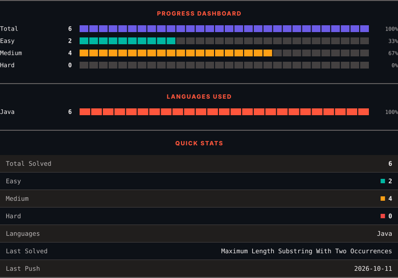
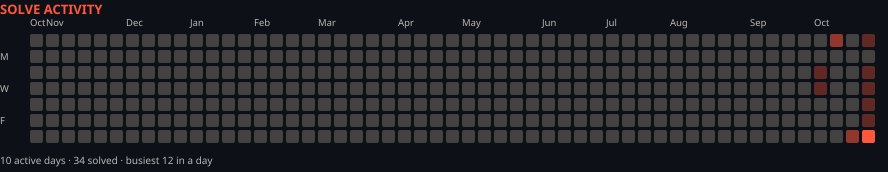

<h1>LeetCode Solutions</h1>

<em>Automatically synced with every accepted submission</em>

   

<picture>
  <source media="(prefers-color-scheme: dark)" srcset=".leetsync/stats-dark.svg">
  <source media="(prefers-color-scheme: light)" srcset=".leetsync/stats-light.svg">
  
</picture>

<picture>
  <source media="(prefers-color-scheme: dark)" srcset=".leetsync/calendar-dark.svg">
  <source media="(prefers-color-scheme: light)" srcset=".leetsync/calendar-light.svg">
  
</picture>

---

### ALL SOLUTIONS

| # | Problem | Difficulty | Language | Date |
|:---:|:--------|:----------:|:--------:|:----:|
| 2 | [Add Two Numbers](problems/0002-Add-Two-Numbers) | 🟧 Medium | `Java` | 2026-10-31 |
| 3 | [Longest Substring Without Repeating Characters](problems/0003-Longest-Substring-Without-Repeating-Characters) | 🟧 Medium | `Java` | 2026-10-11 |
| 19 | [Remove Nth Node From End of List](problems/0019-Remove-Nth-Node-From-End-of-List) | 🟧 Medium | `Java` | 2026-10-30 |
| 34 | [Find First and Last Position of Element in Sorted Array](problems/0034-Find-First-and-Last-Position-of-Element-in-Sorted-Array) | 🟧 Medium | `Java` | 2026-10-25 |
| 56 | [Merge Intervals](problems/0056-Merge-Intervals) | 🟧 Medium | `Java` | 2026-10-28 |
| 57 | [Insert Interval](problems/0057-Insert-Interval) | 🟧 Medium | `Java` | 2026-10-29 |
| 74 | [Search a 2D Matrix](problems/0074-Search-a-2D-Matrix) | 🟧 Medium | `Java` | 2026-10-25 |
| 160 | [Intersection of Two Linked Lists](problems/0160-Intersection-of-Two-Linked-Lists) | 🟩 Easy | `Java` | 2026-10-30 |
| 162 | [Find Peak Element](problems/0162-Find-Peak-Element) | 🟧 Medium | `Java` | 2026-10-24 |
| 209 | [Minimum Size Subarray Sum](problems/0209-Minimum-Size-Subarray-Sum) | 🟧 Medium | `Java` | 2026-10-11 |
| 234 | [Palindrome Linked List](problems/0234-Palindrome-Linked-List) | 🟩 Easy | `Java` | 2026-10-30 |
| 387 | [First Unique Character in a String](problems/0387-First-Unique-Character-in-a-String) | 🟩 Easy | `Java` | 2026-10-24 |
| 875 | [Koko Eating Bananas](problems/0875-Koko-Eating-Bananas) | 🟧 Medium | `Java` | 2026-10-27 |
| 876 | [Middle of the Linked List](problems/0876-Middle-of-the-Linked-List) | 🟩 Easy | `Java` | 2026-10-31 |
| 1011 | [Capacity To Ship Packages Within D Days](problems/1011-Capacity-To-Ship-Packages-Within-D-Days) | 🟧 Medium | `Java` | 2026-10-25 |
| 1095 | [Find in Mountain Array](problems/1095-Find-in-Mountain-Array) | 🟥 Hard | `Java` | 2026-10-24 |
| 1343 | [Number of Sub-arrays of Size K and Average Greater than or Equal to Threshold](problems/1343-Number-of-Sub-arrays-of-Size-K-and-Average-Greater-than-or-Equal-to-Threshold) | 🟧 Medium | `Java` | 2026-10-06 |
| 1431 | [Kids With the Greatest Number of Candies](problems/1431-Kids-With-the-Greatest-Number-of-Candies) | 🟩 Easy | `Java` | 2026-10-24 |
| 1456 | [Maximum Number of Vowels in a Substring of Given Length](problems/1456-Maximum-Number-of-Vowels-in-a-Substring-of-Given-Length) | 🟧 Medium | `Java` | 2026-10-07 |
| 1870 | [Minimum Speed to Arrive on Time](problems/1870-Minimum-Speed-to-Arrive-on-Time) | 🟧 Medium | `Java` | 2026-10-27 |
| 1876 | [Substrings of Size Three with Distinct Characters](problems/1876-Substrings-of-Size-Three-with-Distinct-Characters) | 🟩 Easy | `Java` | 2026-10-07 |
| 2351 | [First Letter to Appear Twice](problems/2351-First-Letter-to-Appear-Twice) | 🟩 Easy | `Java` | 2026-10-24 |
| 2958 | [Length of Longest Subarray With at Most K Frequency](problems/2958-Length-of-Longest-Subarray-With-at-Most-K-Frequency) | 🟧 Medium | `Java` | 2026-10-11 |
| 3090 | [Maximum Length Substring With Two Occurrences](problems/3090-Maximum-Length-Substring-With-Two-Occurrences) | 🟩 Easy | `Java` | 2026-10-11 |

---

Auto-synced by <strong>LeetSync</strong> · Built by <a href="https://deveshsamant.in/">Devesh Samant</a>

