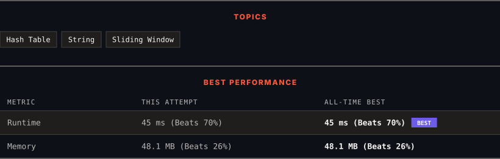

<div align="center">

# 3. Longest Substring Without Repeating Characters

      

[](https://leetcode.com/problems/longest-substring-without-repeating-characters/)

</div>

---

<div align="center">

<picture>
  <source media="(prefers-color-scheme: dark)" srcset="panel-dark.svg">
  <source media="(prefers-color-scheme: light)" srcset="panel-light.svg">
  
</picture>

</div>

> **New personal best** — Runtime improved on this submission.

### HOW IT WENT

| | |
|:--|:--|
| **Attempts** | first try |
| **Time to solve** | 18 min |
| **Verdicts** | ✅ Accepted |

---

### NOTES

_No notes yet._

---

### SOLUTIONS (1)

| # | File | Language | Date |
|:-:|------|:--------:|:----:|
| 1 | [sol1.java](./sol1.java) | `Java` | 2026-10-11 ← **latest** |

---

### PROBLEM DESCRIPTION

Given a string `s`, find the length of the **longest** **substring** without duplicate characters.

 

**Example 1:**

```

**Input:** s = "abcabcbb"
**Output:** 3
**Explanation:** The answer is "abc", with the length of 3. Note that `"bca"` and `"cab"` are also correct answers.

```

**Example 2:**

```

**Input:** s = "bbbbb"
**Output:** 1
**Explanation:** The answer is "b", with the length of 1.

```

**Example 3:**

```

**Input:** s = "pwwkew"
**Output:** 3
**Explanation:** The answer is "wke", with the length of 3.
Notice that the answer must be a substring, "pwke" is a subsequence and not a substring.

```

 

**Constraints:**

	- `0 <= s.length <= 10^5`

	- `s` consists of English letters, digits, symbols and spaces.

---

<div align="center">

<sub>Auto-synced by <strong>LeetSync</strong> · Built by <a href="https://deveshsamant.in/">Devesh Samant</a></sub>

</div>
