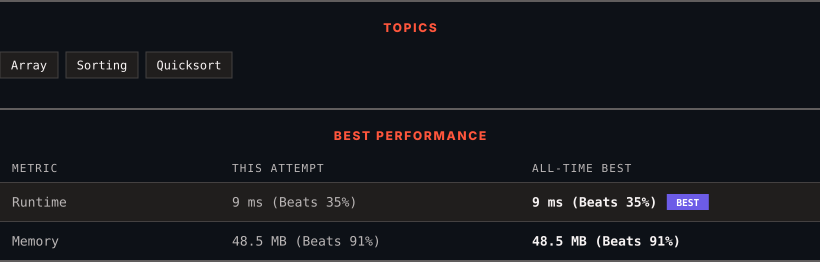

<div align="center">

# 56. Merge Intervals

      

[](https://leetcode.com/problems/merge-intervals/)

</div>

---

<div align="center">

<picture>
  <source media="(prefers-color-scheme: dark)" srcset="panel-dark.svg">
  <source media="(prefers-color-scheme: light)" srcset="panel-light.svg">
  
</picture>

</div>

> **New personal best** — Runtime improved on this submission.

### HOW IT WENT

| | |
|:--|:--|
| **Attempts** | first try |
| **Time to solve** | 7 min |
| **Verdicts** | ✅ Accepted |

---

### NOTES

_No notes yet._

---

### SOLUTIONS (1)

| # | File | Language | Date |
|:-:|------|:--------:|:----:|
| 1 | [sol1.java](./sol1.java) | `Java` | 2026-10-28 ← **latest** |

---

### PROBLEM DESCRIPTION

Given an array of `intervals` where `intervals[i] = [start_i, end_i]`, merge all overlapping intervals, and return *an array of the non-overlapping intervals that cover all the intervals in the input*.

 

**Example 1:**

```

**Input:** intervals = [[1,3],[2,6],[8,10],[15,18]]
**Output:** [[1,6],[8,10],[15,18]]
**Explanation:** Since intervals [1,3] and [2,6] overlap, merge them into [1,6].

```

**Example 2:**

```

**Input:** intervals = [[1,4],[4,5]]
**Output:** [[1,5]]
**Explanation:** Intervals [1,4] and [4,5] are considered overlapping.

```

**Example 3:**

```

**Input:** intervals = [[4,7],[1,4]]
**Output:** [[1,7]]
**Explanation:** Intervals [1,4] and [4,7] are considered overlapping.

```

 

**Constraints:**

	- `1 <= intervals.length <= 10^4`

	- `intervals[i].length == 2`

	- `0 <= start_i <= end_i <= 10^4`

---

<div align="center">

<sub>Auto-synced by <strong>LeetSync</strong> · Built by <a href="https://deveshsamant.in/">Devesh Samant</a></sub>

</div>
