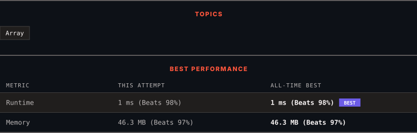

<div align="center">

# 57. Insert Interval

      

[](https://leetcode.com/problems/insert-interval/)

</div>

---

<div align="center">

<picture>
  <source media="(prefers-color-scheme: dark)" srcset="panel-dark.svg">
  <source media="(prefers-color-scheme: light)" srcset="panel-light.svg">
  
</picture>

</div>

> **New personal best** — Runtime improved on this submission.

### HOW IT WENT

| | |
|:--|:--|
| **Attempts** | first try |
| **Time to solve** | 25 h 8 min |
| **Verdicts** | ✅ Accepted |

---

### NOTES

_No notes yet._

---

### SOLUTIONS (1)

| # | File | Language | Date |
|:-:|------|:--------:|:----:|
| 1 | [sol1.java](./sol1.java) | `Java` | 2026-10-29 ← **latest** |

---

### PROBLEM DESCRIPTION

You are given an array of non-overlapping intervals `intervals` where `intervals[i] = [start_i, end_i]` represent the start and the end of the `i^th` interval and `intervals` is sorted in ascending order by `start_i`. You are also given an interval `newInterval = [start, end]` that represents the start and end of another interval.

Two intervals are considered overlapping if they share **at least** one point.

Insert `newInterval` into `intervals` such that `intervals` is still sorted in ascending order by `start_i` and `intervals` still does not have any overlapping intervals (merge overlapping intervals if necessary).

Return `intervals`* after the insertion*.

**Note** that you don't need to modify `intervals` in-place. You can make a new array and return it.

 

**Example 1:**

```

**Input:** intervals = [[1,3],[6,9]], newInterval = [2,5]
**Output:** [[1,5],[6,9]]

```

**Example 2:**

```

**Input:** intervals = [[1,2],[3,5],[6,7],[8,10],[12,16]], newInterval = [4,8]
**Output:** [[1,2],[3,10],[12,16]]
**Explanation:** Because the new interval [4,8] overlaps with [3,5],[6,7],[8,10].

```

 

**Constraints:**

	- `0 <= intervals.length <= 10^4`

	- `intervals[i].length == 2`

	- `0 <= start_i <= end_i <= 10^5`

	- `intervals` is sorted by `start_i` in **ascending** order.

	- `newInterval.length == 2`

	- `0 <= start <= end <= 10^5`

---

<div align="center">

<sub>Auto-synced by <strong>LeetSync</strong> · Built by <a href="https://deveshsamant.in/">Devesh Samant</a></sub>

</div>
