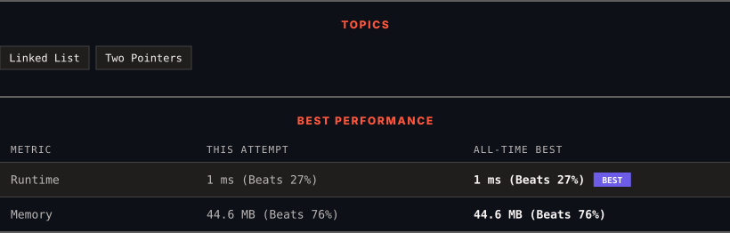

<div align="center">

# 82. Remove Duplicates from Sorted List II

      

[](https://leetcode.com/problems/remove-duplicates-from-sorted-list-ii/)

</div>

---

<div align="center">

<picture>
  <source media="(prefers-color-scheme: dark)" srcset="panel-dark.svg">
  <source media="(prefers-color-scheme: light)" srcset="panel-light.svg">
  
</picture>

</div>

### HOW IT WENT

| | |
|:--|:--|
| **Attempts** | 2 before accepted |
| **Time to solve** | 19 min |
| **Verdicts** | ✅ Accepted → ✅ Accepted |

---

### NOTES

_No notes yet._

---

### SOLUTIONS (2)

| # | File | Language | Date |
|:-:|------|:--------:|:----:|
| 1 | [sol1.java](./sol1.java) | `Java` | 2026-11-01 |
| 2 | [sol2.java](./sol2.java) | `Java` | 2026-11-01 ← **latest** |

---

### PROBLEM DESCRIPTION

You are given the `head` of a **sorted** linked list.

Delete all nodes that have **duplicate** numbers, leaving only **distinct** numbers from the original list.

Return the linked list **sorted** as well.

 

**Example 1:**


```

**Input:** head = [1,2,3,3,4,4,5]
**Output:** [1,2,5]

```

**Example 2:**


```

**Input:** head = [1,1,1,2,3]
**Output:** [2,3]

```

 

**Constraints:**

	- The number of nodes in the list is in the range `[0, 300]`.

	- `-100 <= Node.val <= 100`

	- The list is guaranteed to be **sorted** in ascending order.

---

<div align="center">

<sub>Auto-synced by <strong>LeetSync</strong> · Built by <a href="https://deveshsamant.in/">Devesh Samant</a></sub>

</div>
