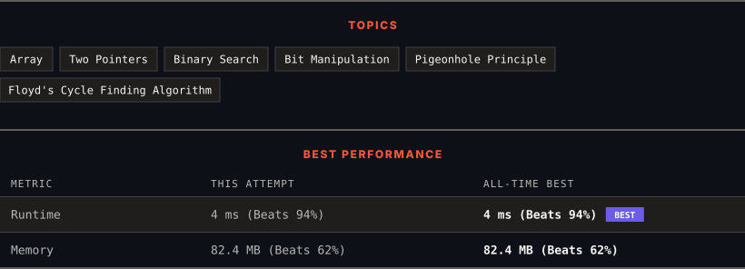

<div align="center">

# 287. Find the Duplicate Number

      

[](https://leetcode.com/problems/find-the-duplicate-number/)

</div>

---

<div align="center">

<picture>
  <source media="(prefers-color-scheme: dark)" srcset="panel-dark.svg">
  <source media="(prefers-color-scheme: light)" srcset="panel-light.svg">
  
</picture>

</div>

> **New personal best** — Runtime improved on this submission.

### HOW IT WENT

| | |
|:--|:--|
| **Attempts** | 2 before accepted |
| **Time to solve** | 3 min |
| **Verdicts** | ✅ Accepted → ✅ Accepted |

---

### NOTES

_No notes yet._

---

### SOLUTIONS (2)

| # | File | Language | Date |
|:-:|------|:--------:|:----:|
| 1 | [sol1.java](./sol1.java) | `Java` | 2026-11-28 |
| 2 | [sol2.java](./sol2.java) | `Java` | 2026-11-28 ← **latest** |

---

### PROBLEM DESCRIPTION

Given an array of integers `nums` containing `n + 1` integers where each integer is in the range `[1, n]` inclusive.

There is only **one repeated number** in `nums`, return *this repeated number*.

You must solve the problem **without** modifying the array `nums` and using only constant extra space.

 

**Example 1:**

```

**Input:** nums = [1,3,4,2,2]
**Output:** 2

```

**Example 2:**

```

**Input:** nums = [3,1,3,4,2]
**Output:** 3

```

**Example 3:**

```

**Input:** nums = [3,3,3,3,3]
**Output:** 3
```

 

**Constraints:**

	- `1 <= n <= 10^5`

	- `nums.length == n + 1`

	- `1 <= nums[i] <= n`

	- All the integers in `nums` appear only **once** except for **precisely one integer** which appears **two or more** times.

 

**Follow up:**

	- How can we prove that at least one duplicate number must exist in `nums`?

	- Can you solve the problem in linear runtime complexity?

---

<div align="center">

<sub>Auto-synced by <strong>LeetSync</strong> · Built by <a href="https://deveshsamant.in/">Devesh Samant</a></sub>

</div>
