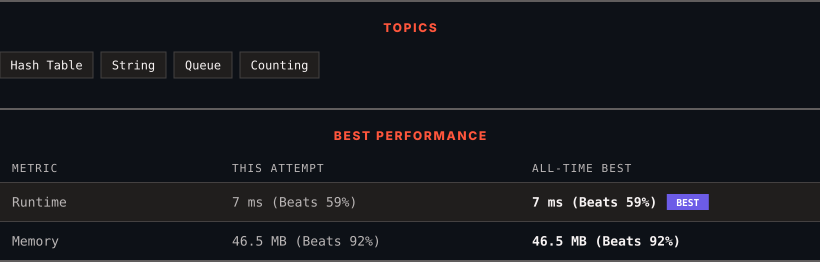

# 387. First Unique Character in a String

      

---

<picture>
  <source media="(prefers-color-scheme: dark)" srcset="panel-dark.svg">
  <source media="(prefers-color-scheme: light)" srcset="panel-light.svg">
  
</picture>

> **New personal best** — Runtime improved on this submission.

### HOW IT WENT

| | |
|:--|:--|
| **Attempts** | first try |
| **Time to solve** | 2 h 10 min |
| **Verdicts** | ✅ Accepted |

---

### NOTES

_No notes yet._

---

### SOLUTIONS (1)

| # | File | Language | Date |
|:-:|------|:--------:|:----:|
| 1 | [sol1.java](./sol1.java) | `Java` | 2026-10-24 ← **latest** |

---

### PROBLEM DESCRIPTION

Given a string `s`, find the **first** non-repeating character in it and return its index. If it **does not** exist, return `-1`.

 

**Example 1:**

**Input:** s = "leetcode"

**Output:** 0

**Explanation:**

The character `'l'` at index 0 is the first character that does not occur at any other index.

**Example 2:**

**Input:** s = "loveleetcode"

**Output:** 2

**Example 3:**

**Input:** s = "aabb"

**Output:** -1

 

**Constraints:**

	- `1 <= s.length <= 10^5`

	- `s` consists of only lowercase English letters.

---

Auto-synced by <strong>LeetSync</strong> · Built by <a href="https://deveshsamant.in/">Devesh Samant</a>

