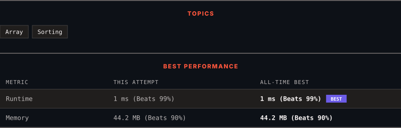

<div align="center">

# 414. Third Maximum Number

      

[](https://leetcode.com/problems/third-maximum-number/)

</div>

---

<div align="center">

<picture>
  <source media="(prefers-color-scheme: dark)" srcset="panel-dark.svg">
  <source media="(prefers-color-scheme: light)" srcset="panel-light.svg">
  
</picture>

</div>

> **New personal best** — Runtime improved on this submission.

### HOW IT WENT

| | |
|:--|:--|
| **Attempts** | 2 before accepted |
| **Time to solve** | 16 min |
| **Verdicts** | ❌ Wrong Answer → ✅ Accepted |

---

### NOTES

_No notes yet._

---

### SOLUTIONS (1)

| # | File | Language | Date |
|:-:|------|:--------:|:----:|
| 1 | [sol1.java](./sol1.java) | `Java` | 2026-11-05 ← **latest** |

---

### PROBLEM DESCRIPTION

You are given an integer array `nums`.

Return the **third distinct maximum** number in this array. If the third **maximum** does not exist, return the **maximum** number.

 

**Example 1:**

```

**Input:** nums = [3,2,1]
**Output:** 1
**Explanation:**
The first distinct maximum is 3.
The second distinct maximum is 2.
The third distinct maximum is 1.

```

**Example 2:**

```

**Input:** nums = [1,2]
**Output:** 2
**Explanation:**
The first distinct maximum is 2.
The second distinct maximum is 1.
The third distinct maximum does not exist, so the maximum (2) is returned instead.

```

**Example 3:**

```

**Input:** nums = [2,2,3,1]
**Output:** 1
**Explanation:**
The first distinct maximum is 3.
The second distinct maximum is 2 (both 2's are counted together since they have the same value).
The third distinct maximum is 1.

```

 

**Constraints:**

	- `1 <= nums.length <= 10^4`

	- `-2^31 <= nums[i] <= 2^31 - 1`

 

**Follow up:** Can you find an `O(n)` solution?

---

<div align="center">

<sub>Auto-synced by <strong>LeetSync</strong> · Built by <a href="https://deveshsamant.in/">Devesh Samant</a></sub>

</div>
