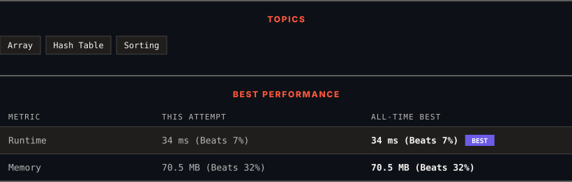

<div align="center">

# 442. Find All Duplicates in an Array

      

[](https://leetcode.com/problems/find-all-duplicates-in-an-array/)

</div>

---

<div align="center">

<picture>
  <source media="(prefers-color-scheme: dark)" srcset="panel-dark.svg">
  <source media="(prefers-color-scheme: light)" srcset="panel-light.svg">
  
</picture>

</div>

> **New personal best** — Runtime improved on this submission.

### HOW IT WENT

| | |
|:--|:--|
| **Attempts** | first try |
| **Time to solve** | 9 min |
| **Verdicts** | ✅ Accepted |

---

### NOTES

_No notes yet._

---

### SOLUTIONS (1)

| # | File | Language | Date |
|:-:|------|:--------:|:----:|
| 1 | [sol1.java](./sol1.java) | `Java` | 2026-11-17 ← **latest** |

---

### PROBLEM DESCRIPTION

Given an integer array `nums` of length `n` where all the integers of `nums` are in the range `[1, n]` and each integer appears **at most** **twice**, return *an array of all the integers that appears **twice***.

You must write an algorithm that runs in `O(n)` time and uses only *constant* auxiliary space, excluding the space needed to store the output

 

**Example 1:**

```
**Input:** nums = [4,3,2,7,8,2,3,1]
**Output:** [2,3]

```

**Example 2:**

```
**Input:** nums = [1,1,2]
**Output:** [1]

```

**Example 3:**

```
**Input:** nums = [1]
**Output:** []

```

 

**Constraints:**

	- `n == nums.length`

	- `1 <= n <= 10^5`

	- `1 <= nums[i] <= n`

	- Each element in `nums` appears **once** or **twice**.

---

<div align="center">

<sub>Auto-synced by <strong>LeetSync</strong> · Built by <a href="https://deveshsamant.in/">Devesh Samant</a></sub>

</div>
