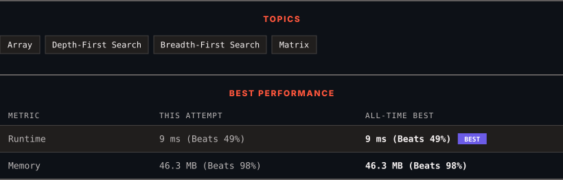

<div align="center">

# 463. Island Perimeter

      

[](https://leetcode.com/problems/island-perimeter/)

</div>

---

<div align="center">

<picture>
  <source media="(prefers-color-scheme: dark)" srcset="panel-dark.svg">
  <source media="(prefers-color-scheme: light)" srcset="panel-light.svg">
  
</picture>

</div>

> **New personal best** — Runtime improved on this submission.

### HOW IT WENT

| | |
|:--|:--|
| **Attempts** | 2 before accepted |
| **Time to solve** | 21 min |
| **Verdicts** | ❌ Wrong Answer → ✅ Accepted |

---

### NOTES

_No notes yet._

---

### SOLUTIONS (1)

| # | File | Language | Date |
|:-:|------|:--------:|:----:|
| 1 | [sol1.java](./sol1.java) | `Java` | 2026-11-22 ← **latest** |

---

### PROBLEM DESCRIPTION

You are given `row x col` `grid` representing a map where `grid[i][j] = 1` represents land and `grid[i][j] = 0` represents water.

Grid cells are connected **horizontally/vertically** (not diagonally). The `grid` is completely surrounded by water, and there is exactly one island (i.e., one or more connected land cells).

The island doesn't have "lakes", meaning the water inside isn't connected to the water around the island. One cell is a square with side length 1. The grid is rectangular, width and height don't exceed 100. Determine the perimeter of the island.

 

**Example 1:**


```

**Input:** grid = [[0,1,0,0],[1,1,1,0],[0,1,0,0],[1,1,0,0]]
**Output:** 16
**Explanation:** The perimeter is the 16 yellow stripes in the image above.

```

**Example 2:**

```

**Input:** grid = [[1]]
**Output:** 4

```

**Example 3:**

```

**Input:** grid = [[1,0]]
**Output:** 4

```

 

**Constraints:**

	- `row == grid.length`

	- `col == grid[i].length`

	- `1 <= row, col <= 100`

	- `grid[i][j]` is `0` or `1`.

	- There is exactly one island in `grid`.

---

<div align="center">

<sub>Auto-synced by <strong>LeetSync</strong> · Built by <a href="https://deveshsamant.in/">Devesh Samant</a></sub>

</div>
