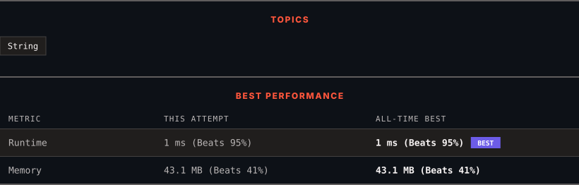

<div align="center">

# 520. Detect Capital

      

[](https://leetcode.com/problems/detect-capital/)

</div>

---

<div align="center">

<picture>
  <source media="(prefers-color-scheme: dark)" srcset="panel-dark.svg">
  <source media="(prefers-color-scheme: light)" srcset="panel-light.svg">
  
</picture>

</div>

> **New personal best** — Runtime improved on this submission.

### HOW IT WENT

| | |
|:--|:--|
| **Attempts** | first try |
| **Time to solve** | under a minute |
| **Verdicts** | ✅ Accepted |

---

### NOTES

_No notes yet._

---

### SOLUTIONS (1)

| # | File | Language | Date |
|:-:|------|:--------:|:----:|
| 1 | [sol1.java](./sol1.java) | `Java` | 2026-11-22 ← **latest** |

---

### PROBLEM DESCRIPTION

We define the usage of capitals in a word to be right when one of the following cases holds:

	- All letters in this word are capitals, like `"USA"`.

	- All letters in this word are not capitals, like `"leetcode"`.

	- Only the first letter in this word is capital, like `"Google"`.

Given a string `word`, return `true` if the usage of capitals in it is right.

 

**Example 1:**

```
**Input:** word = "USA"
**Output:** true

```

**Example 2:**

```
**Input:** word = "FlaG"
**Output:** false

```

 

**Constraints:**

	- `1 <= word.length <= 100`

	- `word` consists of lowercase and uppercase English letters.

---

<div align="center">

<sub>Auto-synced by <strong>LeetSync</strong> · Built by <a href="https://deveshsamant.in/">Devesh Samant</a></sub>

</div>
