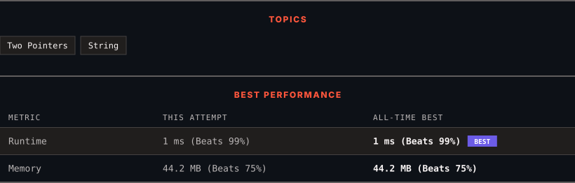

<div align="center">

# 541. Reverse String II

      

[](https://leetcode.com/problems/reverse-string-ii/)

</div>

---

<div align="center">

<picture>
  <source media="(prefers-color-scheme: dark)" srcset="panel-dark.svg">
  <source media="(prefers-color-scheme: light)" srcset="panel-light.svg">
  
</picture>

</div>

> **New personal best** — Runtime improved on this submission.

### HOW IT WENT

| | |
|:--|:--|
| **Attempts** | first try |
| **Time to solve** | under a minute |
| **Verdicts** | ✅ Accepted |

---

### NOTES

_No notes yet._

---

### SOLUTIONS (1)

| # | File | Language | Date |
|:-:|------|:--------:|:----:|
| 1 | [sol1.java](./sol1.java) | `Java` | 2026-11-28 ← **latest** |

---

### PROBLEM DESCRIPTION

Given a string `s` and an integer `k`, reverse the first `k` characters for every `2k` characters counting from the start of the string.

If there are fewer than `k` characters left, reverse all of them. If there are less than `2k` but greater than or equal to `k` characters, then reverse the first `k` characters and leave the other as original.

 

**Example 1:**

```
**Input:** s = "abcdefg", k = 2
**Output:** "bacdfeg"

```

**Example 2:**

```
**Input:** s = "abcd", k = 2
**Output:** "bacd"

```

 

**Constraints:**

	- `1 <= s.length <= 10^4`

	- `s` consists of only lowercase English letters.

	- `1 <= k <= 10^4`

---

<div align="center">

<sub>Auto-synced by <strong>LeetSync</strong> · Built by <a href="https://deveshsamant.in/">Devesh Samant</a></sub>

</div>
