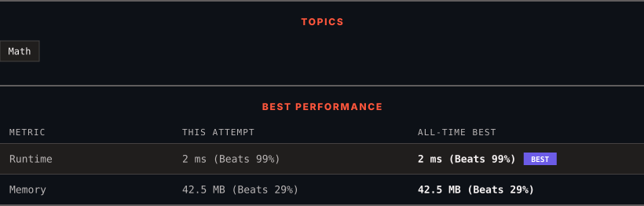

<div align="center">

# 728. Self Dividing Numbers

      

[](https://leetcode.com/problems/self-dividing-numbers/)

</div>

---

<div align="center">

<picture>
  <source media="(prefers-color-scheme: dark)" srcset="panel-dark.svg">
  <source media="(prefers-color-scheme: light)" srcset="panel-light.svg">
  
</picture>

</div>

> **New personal best** — Runtime improved on this submission.

### HOW IT WENT

| | |
|:--|:--|
| **Attempts** | first try |
| **Time to solve** | under a minute |
| **Verdicts** | ✅ Accepted |

---

### NOTES

_No notes yet._

---

### SOLUTIONS (1)

| # | File | Language | Date |
|:-:|------|:--------:|:----:|
| 1 | [sol1.java](./sol1.java) | `Java` | 2026-11-22 ← **latest** |

---

### PROBLEM DESCRIPTION

A **self-dividing number** is a number that is divisible by every digit it contains.

	- For example, `128` is **a self-dividing number** because `128 % 1 == 0`, `128 % 2 == 0`, and `128 % 8 == 0`.

A **self-dividing number** is not allowed to contain the digit zero.

Given two integers `left` and `right`, return *a list of all the **self-dividing numbers** in the range* `[left, right]` (both **inclusive**).

 

**Example 1:**

```
**Input:** left = 1, right = 22
**Output:** [1,2,3,4,5,6,7,8,9,11,12,15,22]

```

**Example 2:**

```
**Input:** left = 47, right = 85
**Output:** [48,55,66,77]

```

 

**Constraints:**

	- `1 <= left <= right <= 10^4`

---

<div align="center">

<sub>Auto-synced by <strong>LeetSync</strong> · Built by <a href="https://deveshsamant.in/">Devesh Samant</a></sub>

</div>
