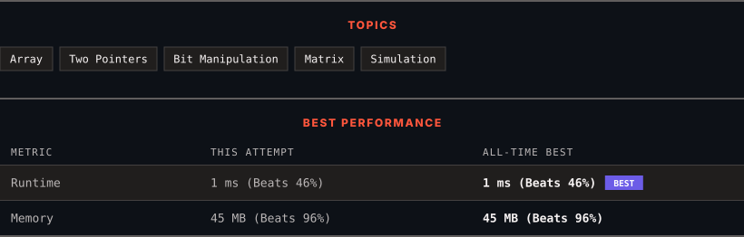

<div align="center">

# 832. Flipping an Image

      

[](https://leetcode.com/problems/flipping-an-image/)

</div>

---

<div align="center">

<picture>
  <source media="(prefers-color-scheme: dark)" srcset="panel-dark.svg">
  <source media="(prefers-color-scheme: light)" srcset="panel-light.svg">
  
</picture>

</div>

> **New personal best** — Runtime improved on this submission.

### HOW IT WENT

| | |
|:--|:--|
| **Attempts** | first try |
| **Time to solve** | under a minute |
| **Verdicts** | ✅ Accepted |

---

### NOTES

_No notes yet._

---

### SOLUTIONS (1)

| # | File | Language | Date |
|:-:|------|:--------:|:----:|
| 1 | [sol1.java](./sol1.java) | `Java` | 2026-11-24 ← **latest** |

---

### PROBLEM DESCRIPTION

Given an `n x n` binary matrix `image`, flip the image **horizontally**, then invert it, and return *the resulting image*.

To flip an image horizontally means that each row of the image is reversed.

	- For example, flipping `[1,1,0]` horizontally results in `[0,1,1]`.

To invert an image means that each `0` is replaced by `1`, and each `1` is replaced by `0`.

	- For example, inverting `[0,1,1]` results in `[1,0,0]`.

 

**Example 1:**

```

**Input:** image = [[1,1,0],[1,0,1],[0,0,0]]
**Output:** [[1,0,0],[0,1,0],[1,1,1]]
**Explanation:** First reverse each row: [[0,1,1],[1,0,1],[0,0,0]].
Then, invert the image: [[1,0,0],[0,1,0],[1,1,1]]

```

**Example 2:**

```

**Input:** image = [[1,1,0,0],[1,0,0,1],[0,1,1,1],[1,0,1,0]]
**Output:** [[1,1,0,0],[0,1,1,0],[0,0,0,1],[1,0,1,0]]
**Explanation:** First reverse each row: [[0,0,1,1],[1,0,0,1],[1,1,1,0],[0,1,0,1]].
Then invert the image: [[1,1,0,0],[0,1,1,0],[0,0,0,1],[1,0,1,0]]

```

 

**Constraints:**

	- `n == image.length`

	- `n == image[i].length`

	- `1 <= n <= 20`

	- `images[i][j]` is either `0` or `1`.

---

<div align="center">

<sub>Auto-synced by <strong>LeetSync</strong> · Built by <a href="https://deveshsamant.in/">Devesh Samant</a></sub>

</div>
