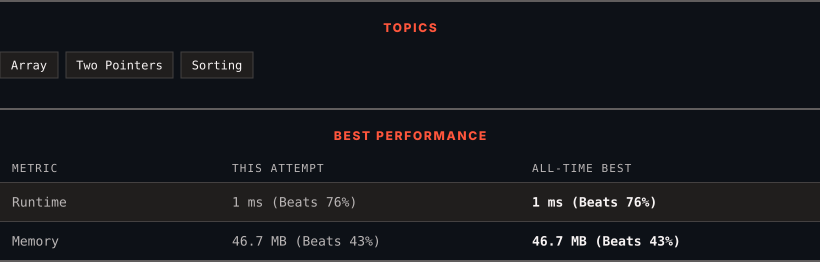

<div align="center">

# 905. Sort Array By Parity

      

[](https://leetcode.com/problems/sort-array-by-parity/)

</div>

---

<div align="center">

<picture>
  <source media="(prefers-color-scheme: dark)" srcset="panel-dark.svg">
  <source media="(prefers-color-scheme: light)" srcset="panel-light.svg">
  
</picture>

</div>

### HOW IT WENT

| | |
|:--|:--|
| **Attempts** | 2 before accepted |
| **Time to solve** | 2 min |
| **Verdicts** | ✅ Accepted → ✅ Accepted |

---

### NOTES

_No notes yet._

---

### SOLUTIONS (2)

| # | File | Language | Date |
|:-:|------|:--------:|:----:|
| 1 | [sol1.java](./sol1.java) | `Java` | 2026-11-24 |
| 2 | [sol2.java](./sol2.java) | `Java` | 2026-11-24 ← **latest** |

---

### PROBLEM DESCRIPTION

Given an integer array `nums`, move all the even integers at the beginning of the array followed by all the odd integers.

Return ***any array** that satisfies this condition*.

 

**Example 1:**

```

**Input:** nums = [3,1,2,4]
**Output:** [2,4,3,1]
**Explanation:** The outputs [4,2,3,1], [2,4,1,3], and [4,2,1,3] would also be accepted.

```

**Example 2:**

```

**Input:** nums = [0]
**Output:** [0]

```

 

**Constraints:**

	- `1 <= nums.length <= 5000`

	- `0 <= nums[i] <= 5000`

---

<div align="center">

<sub>Auto-synced by <strong>LeetSync</strong> · Built by <a href="https://deveshsamant.in/">Devesh Samant</a></sub>

</div>
