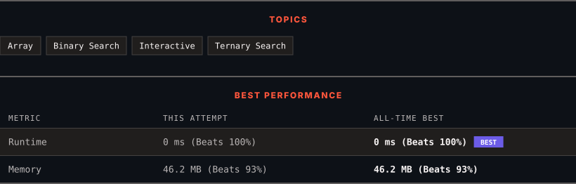

<div align="center">

# 1095. Find in Mountain Array

      

[](https://leetcode.com/problems/find-in-mountain-array/)

</div>

---

<div align="center">

<picture>
  <source media="(prefers-color-scheme: dark)" srcset="panel-dark.svg">
  <source media="(prefers-color-scheme: light)" srcset="panel-light.svg">
  
</picture>

</div>

### HOW IT WENT

| | |
|:--|:--|
| **Attempts** | 2 before accepted |
| **Time to solve** | 5 min |
| **Verdicts** | ✅ Accepted → ✅ Accepted |

---

### NOTES

_No notes yet._

---

### SOLUTIONS (2)

| # | File | Language | Date |
|:-:|------|:--------:|:----:|
| 1 | [sol1.java](./sol1.java) | `Java` | 2026-10-24 |
| 2 | [sol2.java](./sol2.java) | `Java` | 2026-10-24 ← **latest** |

---

### PROBLEM DESCRIPTION

*(This problem is an **interactive problem**.)*

You may recall that an array `arr` is a **mountain array** if and only if:

	- `arr.length >= 3`

	- There exists some `i` with `0 < i < arr.length - 1` such that:
	

		`arr[0] < arr[1] < ... < arr[i - 1] < arr[i]`

		- `arr[i] > arr[i + 1] > ... > arr[arr.length - 1]`

	

	

Given a mountain array `mountainArr`, return the **minimum** `index` such that `mountainArr.get(index) == target`. If such an `index` does not exist, return `-1`.

**You cannot access the mountain array directly.** You may only access the array using a `MountainArray` interface:

	- `MountainArray.get(k)` returns the element of the array at index `k` (0-indexed).

	- `MountainArray.length()` returns the length of the array.

Submissions making more than `100` calls to `MountainArray.get` will be judged *Wrong Answer*. Also, any solutions that attempt to circumvent the judge will result in disqualification.

 

**Example 1:**

```

**Input:** mountainArr = [1,2,3,4,5,3,1], target = 3
**Output:** 2
**Explanation:** 3 exists in the array, at index=2 and index=5. Return the minimum index, which is 2.
```

**Example 2:**

```

**Input:** mountainArr = [0,1,2,4,2,1], target = 3
**Output:** -1
**Explanation:** 3 does not exist in `the array,` so we return -1.

```

 

**Constraints:**

	- `3 <= mountainArr.length() <= 10^4`

	- `0 <= target <= 10^9`

	- `0 <= mountainArr.get(index) <= 10^9`

---

<div align="center">

<sub>Auto-synced by <strong>LeetSync</strong> · Built by <a href="https://deveshsamant.in/">Devesh Samant</a></sub>

</div>
