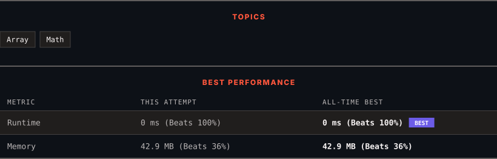

<div align="center">

# 1304. Find N Unique Integers Sum up to Zero

      

[](https://leetcode.com/problems/find-n-unique-integers-sum-up-to-zero/)

</div>

---

<div align="center">

<picture>
  <source media="(prefers-color-scheme: dark)" srcset="panel-dark.svg">
  <source media="(prefers-color-scheme: light)" srcset="panel-light.svg">
  
</picture>

</div>

> **New personal best** — Runtime improved on this submission.

### HOW IT WENT

| | |
|:--|:--|
| **Attempts** | first try |
| **Time to solve** | 7 min |
| **Verdicts** | ✅ Accepted |

---

### NOTES

_No notes yet._

---

### SOLUTIONS (1)

| # | File | Language | Date |
|:-:|------|:--------:|:----:|
| 1 | [sol1.java](./sol1.java) | `Java` | 2026-11-27 ← **latest** |

---

### PROBLEM DESCRIPTION

Given an integer `n`, return **any** array containing `n` **unique** integers such that they add up to `0`.

 

**Example 1:**

```

**Input:** n = 5
**Output:** [-7,-1,1,3,4]
**Explanation:** These arrays also are accepted [-5,-1,1,2,3] , [-3,-1,2,-2,4].

```

**Example 2:**

```

**Input:** n = 3
**Output:** [-1,0,1]

```

**Example 3:**

```

**Input:** n = 1
**Output:** [0]

```

 

**Constraints:**

	- `1 <= n <= 1000`

---

<div align="center">

<sub>Auto-synced by <strong>LeetSync</strong> · Built by <a href="https://deveshsamant.in/">Devesh Samant</a></sub>

</div>
