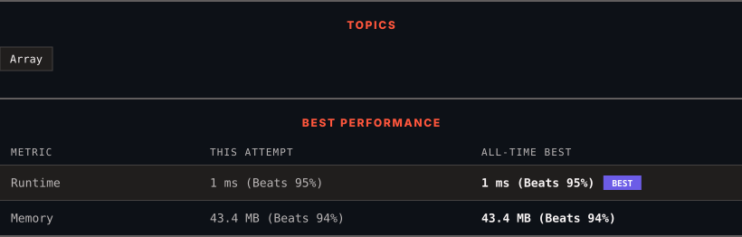

<div align="center">

# 1431. Kids With the Greatest Number of Candies

      

[](https://leetcode.com/problems/kids-with-the-greatest-number-of-candies/)

</div>

---

<div align="center">

<picture>
  <source media="(prefers-color-scheme: dark)" srcset="panel-dark.svg">
  <source media="(prefers-color-scheme: light)" srcset="panel-light.svg">
  
</picture>

</div>

> **New personal best** — Runtime improved on this submission.

### HOW IT WENT

| | |
|:--|:--|
| **Attempts** | first try |
| **Time to solve** | 6 min |
| **Verdicts** | ✅ Accepted |

---

### NOTES

_No notes yet._

---

### SOLUTIONS (1)

| # | File | Language | Date |
|:-:|------|:--------:|:----:|
| 1 | [sol1.java](./sol1.java) | `Java` | 2026-10-24 ← **latest** |

---

### PROBLEM DESCRIPTION

There are `n` kids with candies. You are given an integer array `candies`, where each `candies[i]` represents the number of candies the `i^th` kid has, and an integer `extraCandies`, denoting the number of extra candies that you have.

Return *a boolean array *`result`* of length *`n`*, where *`result[i]`* is *`true`* if, after giving the *`i^th`* kid all the *`extraCandies`*, they will have the **greatest** number of candies among all the kids**, or *`false`* otherwise*.

Note that **multiple** kids can have the **greatest** number of candies.

 

**Example 1:**

```

**Input:** candies = [2,3,5,1,3], extraCandies = 3
**Output:** [true,true,true,false,true] 
**Explanation:** If you give all extraCandies to:
- Kid 1, they will have 2 + 3 = 5 candies, which is the greatest among the kids.
- Kid 2, they will have 3 + 3 = 6 candies, which is the greatest among the kids.
- Kid 3, they will have 5 + 3 = 8 candies, which is the greatest among the kids.
- Kid 4, they will have 1 + 3 = 4 candies, which is not the greatest among the kids.
- Kid 5, they will have 3 + 3 = 6 candies, which is the greatest among the kids.

```

**Example 2:**

```

**Input:** candies = [4,2,1,1,2], extraCandies = 1
**Output:** [true,false,false,false,false] 
**Explanation:** There is only 1 extra candy.
Kid 1 will always have the greatest number of candies, even if a different kid is given the extra candy.

```

**Example 3:**

```

**Input:** candies = [12,1,12], extraCandies = 10
**Output:** [true,false,true]

```

 

**Constraints:**

	- `n == candies.length`

	- `2 <= n <= 100`

	- `1 <= candies[i] <= 100`

	- `1 <= extraCandies <= 50`

---

<div align="center">

<sub>Auto-synced by <strong>LeetSync</strong> · Built by <a href="https://deveshsamant.in/">Devesh Samant</a></sub>

</div>
