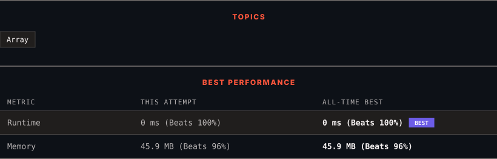

<div align="center">

# 1470. Shuffle the Array

      

[](https://leetcode.com/problems/shuffle-the-array/)

</div>

---

<div align="center">

<picture>
  <source media="(prefers-color-scheme: dark)" srcset="panel-dark.svg">
  <source media="(prefers-color-scheme: light)" srcset="panel-light.svg">
  
</picture>

</div>

> **New personal best** — Runtime improved on this submission.

### HOW IT WENT

| | |
|:--|:--|
| **Attempts** | first try |
| **Time to solve** | 55 min |
| **Verdicts** | ✅ Accepted |

---

### NOTES

_No notes yet._

---

### SOLUTIONS (1)

| # | File | Language | Date |
|:-:|------|:--------:|:----:|
| 1 | [sol1.java](./sol1.java) | `Java` | 2026-11-03 ← **latest** |

---

### PROBLEM DESCRIPTION

Given the array `nums` consisting of `2n` elements in the form `[x_1,x_2,...,x_n,y_1,y_2,...,y_n]`.


*Return the array in the form* `[x_1,y_1,x_2,y_2,...,x_n,y_n]`.


 


**Example 1:**


```

**Input:** nums = [2,5,1,3,4,7], n = 3
**Output:** [2,3,5,4,1,7] 
**Explanation:** Since x_1=2, x_2=5, x_3=1, y_1=3, y_2=4, y_3=7 then the answer is [2,3,5,4,1,7].

```


**Example 2:**


```

**Input:** nums = [1,2,3,4,4,3,2,1], n = 4
**Output:** [1,4,2,3,3,2,4,1]

```


**Example 3:**


```

**Input:** nums = [1,1,2,2], n = 2
**Output:** [1,2,1,2]

```


 


**Constraints:**


	- `1 <= n <= 500`

	- `nums.length == 2n`

	- `1 <= nums[i] <= 10^3`

---

<div align="center">

<sub>Auto-synced by <strong>LeetSync</strong> · Built by <a href="https://deveshsamant.in/">Devesh Samant</a></sub>

</div>
