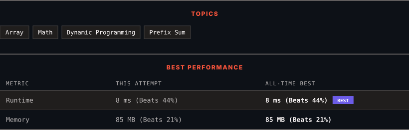

<div align="center">

# 1524. Number of Sub-arrays With Odd Sum

      

[](https://leetcode.com/problems/number-of-sub-arrays-with-odd-sum/)

</div>

---

<div align="center">

<picture>
  <source media="(prefers-color-scheme: dark)" srcset="panel-dark.svg">
  <source media="(prefers-color-scheme: light)" srcset="panel-light.svg">
  
</picture>

</div>

> **New personal best** — Runtime improved on this submission.

### HOW IT WENT

| | |
|:--|:--|
| **Attempts** | first try |
| **Time to solve** | 4 min |
| **Verdicts** | ✅ Accepted |

---

### NOTES

_No notes yet._

---

### SOLUTIONS (1)

| # | File | Language | Date |
|:-:|------|:--------:|:----:|
| 1 | [sol1.java](./sol1.java) | `Java` | 2026-11-15 ← **latest** |

---

### PROBLEM DESCRIPTION

Given an array of integers `arr`, return *the number of subarrays with an **odd** sum*.

Since the answer can be very large, return it modulo `10^9 + 7`.

 

**Example 1:**

```

**Input:** arr = [1,3,5]
**Output:** 4
**Explanation:** All subarrays are [[1],[1,3],[1,3,5],[3],[3,5],[5]]
All sub-arrays sum are [1,4,9,3,8,5].
Odd sums are [1,9,3,5] so the answer is 4.

```

**Example 2:**

```

**Input:** arr = [2,4,6]
**Output:** 0
**Explanation:** All subarrays are [[2],[2,4],[2,4,6],[4],[4,6],[6]]
All sub-arrays sum are [2,6,12,4,10,6].
All sub-arrays have even sum and the answer is 0.

```

**Example 3:**

```

**Input:** arr = [1,2,3,4,5,6,7]
**Output:** 16

```

 

**Constraints:**

	- `1 <= arr.length <= 10^5`

	- `1 <= arr[i] <= 100`

---

<div align="center">

<sub>Auto-synced by <strong>LeetSync</strong> · Built by <a href="https://deveshsamant.in/">Devesh Samant</a></sub>

</div>
