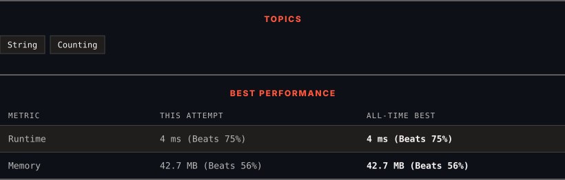

<div align="center">

# 1704. Determine if String Halves Are Alike

      

[](https://leetcode.com/problems/determine-if-string-halves-are-alike/)

</div>

---

<div align="center">

<picture>
  <source media="(prefers-color-scheme: dark)" srcset="panel-dark.svg">
  <source media="(prefers-color-scheme: light)" srcset="panel-light.svg">
  
</picture>

</div>

> **New personal best** — Runtime improved on this submission.

### HOW IT WENT

| | |
|:--|:--|
| **Attempts** | first try |
| **Time to solve** | 10 min |
| **Verdicts** | ✅ Accepted |

---

### NOTES

_No notes yet._

---

### SOLUTIONS (1)

| # | File | Language | Date |
|:-:|------|:--------:|:----:|
| 1 | [sol1.java](./sol1.java) | `Java` | 2026-11-27 ← **latest** |

---

### PROBLEM DESCRIPTION

You are given a string `s` of even length. Split this string into two halves of equal lengths, and let `a` be the first half and `b` be the second half.

Two strings are **alike** if they have the same number of vowels (`'a'`, `'e'`, `'i'`, `'o'`, `'u'`, `'A'`, `'E'`, `'I'`, `'O'`, `'U'`). Notice that `s` contains uppercase and lowercase letters.

Return `true`* if *`a`* and *`b`* are **alike***. Otherwise, return `false`.

 

**Example 1:**

```

**Input:** s = "book"
**Output:** true
**Explanation:** a = "bo" and b = "ok". a has 1 vowel and b has 1 vowel. Therefore, they are alike.

```

**Example 2:**

```

**Input:** s = "textbook"
**Output:** false
**Explanation:** a = "text" and b = "book". a has 1 vowel whereas b has 2. Therefore, they are not alike.
Notice that the vowel o is counted twice.

```

 

**Constraints:**

	- `2 <= s.length <= 1000`

	- `s.length` is even.

	- `s` consists of **uppercase and lowercase** letters.

---

<div align="center">

<sub>Auto-synced by <strong>LeetSync</strong> · Built by <a href="https://deveshsamant.in/">Devesh Samant</a></sub>

</div>
