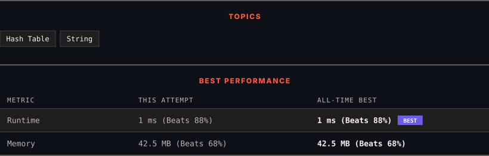

<div align="center">

# 1832. Check if the Sentence Is Pangram

      

[](https://leetcode.com/problems/check-if-the-sentence-is-pangram/)

</div>

---

<div align="center">

<picture>
  <source media="(prefers-color-scheme: dark)" srcset="panel-dark.svg">
  <source media="(prefers-color-scheme: light)" srcset="panel-light.svg">
  
</picture>

</div>

> **New personal best** — Runtime improved on this submission.

### HOW IT WENT

| | |
|:--|:--|
| **Attempts** | first try |
| **Time to solve** | 3 min |
| **Verdicts** | ✅ Accepted |

---

### NOTES

_No notes yet._

---

### SOLUTIONS (1)

| # | File | Language | Date |
|:-:|------|:--------:|:----:|
| 1 | [sol1.java](./sol1.java) | `Java` | 2026-11-23 ← **latest** |

---

### PROBLEM DESCRIPTION

A **pangram** is a sentence where every letter of the English alphabet appears at least once.

Given a string `sentence` containing only lowercase English letters, return* *`true`* if *`sentence`* is a **pangram**, or *`false`* otherwise.*

 

**Example 1:**

```

**Input:** sentence = "thequickbrownfoxjumpsoverthelazydog"
**Output:** true
**Explanation:** sentence contains at least one of every letter of the English alphabet.

```

**Example 2:**

```

**Input:** sentence = "leetcode"
**Output:** false

```

 

**Constraints:**

	- `1 <= sentence.length <= 1000`

	- `sentence` consists of lowercase English letters.

---

<div align="center">

<sub>Auto-synced by <strong>LeetSync</strong> · Built by <a href="https://deveshsamant.in/">Devesh Samant</a></sub>

</div>
