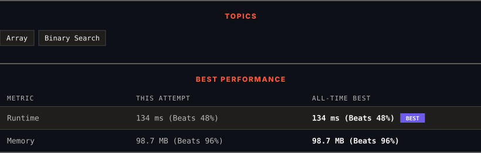

<div align="center">

# 1870. Minimum Speed to Arrive on Time

      

[](https://leetcode.com/problems/minimum-speed-to-arrive-on-time/)

</div>

---

<div align="center">

<picture>
  <source media="(prefers-color-scheme: dark)" srcset="panel-dark.svg">
  <source media="(prefers-color-scheme: light)" srcset="panel-light.svg">
  
</picture>

</div>

> **New personal best** — Runtime improved on this submission.

### HOW IT WENT

| | |
|:--|:--|
| **Attempts** | first try |
| **Time to solve** | under a minute |
| **Verdicts** | ✅ Accepted |

---

### NOTES

_No notes yet._

---

### SOLUTIONS (1)

| # | File | Language | Date |
|:-:|------|:--------:|:----:|
| 1 | [sol1.java](./sol1.java) | `Java` | 2026-10-27 ← **latest** |

---

### PROBLEM DESCRIPTION

You are given a floating-point number `hour`, representing the amount of time you have to reach the office. To commute to the office, you must take `n` trains in sequential order. You are also given an integer array `dist` of length `n`, where `dist[i]` describes the distance (in kilometers) of the `i^th` train ride.

Each train can only depart at an integer hour, so you may need to wait in between each train ride.

	- For example, if the `1^st` train ride takes `1.5` hours, you must wait for an additional `0.5` hours before you can depart on the `2^nd` train ride at the 2 hour mark.

Return *the **minimum positive integer** speed **(in kilometers per hour)** that all the trains must travel at for you to reach the office on time, or *`-1`* if it is impossible to be on time*.

Tests are generated such that the answer will not exceed `10^7` and `hour` will have **at most two digits after the decimal point**.

 

**Example 1:**

```

**Input:** dist = [1,3,2], hour = 6
**Output:** 1
**Explanation: **At speed 1:
- The first train ride takes 1/1 = 1 hour.
- Since we are already at an integer hour, we depart immediately at the 1 hour mark. The second train takes 3/1 = 3 hours.
- Since we are already at an integer hour, we depart immediately at the 4 hour mark. The third train takes 2/1 = 2 hours.
- You will arrive at exactly the 6 hour mark.

```

**Example 2:**

```

**Input:** dist = [1,3,2], hour = 2.7
**Output:** 3
**Explanation: **At speed 3:
- The first train ride takes 1/3 = 0.33333 hours.
- Since we are not at an integer hour, we wait until the 1 hour mark to depart. The second train ride takes 3/3 = 1 hour.
- Since we are already at an integer hour, we depart immediately at the 2 hour mark. The third train takes 2/3 = 0.66667 hours.
- You will arrive at the 2.66667 hour mark.

```

**Example 3:**

```

**Input:** dist = [1,3,2], hour = 1.9
**Output:** -1
**Explanation:** It is impossible because the earliest the third train can depart is at the 2 hour mark.

```

 

**Constraints:**

	- `n == dist.length`

	- `1 <= n <= 10^5`

	- `1 <= dist[i] <= 10^5`

	- `1 <= hour <= 10^9`

	- There will be at most two digits after the decimal point in `hour`.

---

<div align="center">

<sub>Auto-synced by <strong>LeetSync</strong> · Built by <a href="https://deveshsamant.in/">Devesh Samant</a></sub>

</div>
