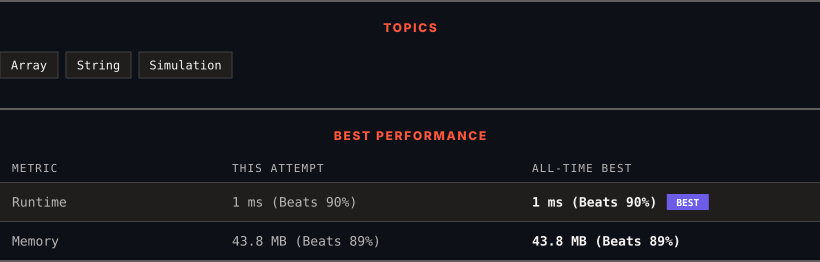

<div align="center">

# 2011. Final Value of Variable After Performing Operations

      

[](https://leetcode.com/problems/final-value-of-variable-after-performing-operations/)

</div>

---

<div align="center">

<picture>
  <source media="(prefers-color-scheme: dark)" srcset="panel-dark.svg">
  <source media="(prefers-color-scheme: light)" srcset="panel-light.svg">
  
</picture>

</div>

> **New personal best** — Runtime improved on this submission.

### HOW IT WENT

| | |
|:--|:--|
| **Attempts** | first try |
| **Time to solve** | under a minute |
| **Verdicts** | ✅ Accepted |

---

### NOTES

_No notes yet._

---

### SOLUTIONS (1)

| # | File | Language | Date |
|:-:|------|:--------:|:----:|
| 1 | [sol1.java](./sol1.java) | `Java` | 2026-11-23 ← **latest** |

---

### PROBLEM DESCRIPTION

There is a programming language with only **four** operations and **one** variable `X`:

	- `++X` and `X++` **increments** the value of the variable `X` by `1`.

	- `--X` and `X--` **decrements** the value of the variable `X` by `1`.

Initially, the value of `X` is `0`.

Given an array of strings `operations` containing a list of operations, return *the **final **value of *`X` *after performing all the operations*.

 

**Example 1:**

```

**Input:** operations = ["--X","X++","X++"]
**Output:** 1
**Explanation:** The operations are performed as follows:
Initially, X = 0.
--X: X is decremented by 1, X =  0 - 1 = -1.
X++: X is incremented by 1, X = -1 + 1 =  0.
X++: X is incremented by 1, X =  0 + 1 =  1.

```

**Example 2:**

```

**Input:** operations = ["++X","++X","X++"]
**Output:** 3
**Explanation: **The operations are performed as follows:
Initially, X = 0.
++X: X is incremented by 1, X = 0 + 1 = 1.
++X: X is incremented by 1, X = 1 + 1 = 2.
X++: X is incremented by 1, X = 2 + 1 = 3.

```

**Example 3:**

```

**Input:** operations = ["X++","++X","--X","X--"]
**Output:** 0
**Explanation:** The operations are performed as follows:
Initially, X = 0.
X++: X is incremented by 1, X = 0 + 1 = 1.
++X: X is incremented by 1, X = 1 + 1 = 2.
--X: X is decremented by 1, X = 2 - 1 = 1.
X--: X is decremented by 1, X = 1 - 1 = 0.

```

 

**Constraints:**

	- `1 <= operations.length <= 100`

	- `operations[i]` will be either `"++X"`, `"X++"`, `"--X"`, or `"X--"`.

---

<div align="center">

<sub>Auto-synced by <strong>LeetSync</strong> · Built by <a href="https://deveshsamant.in/">Devesh Samant</a></sub>

</div>
