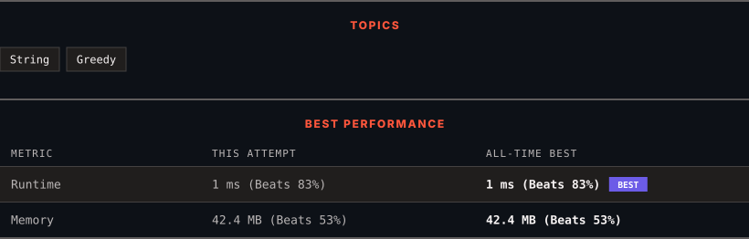

<div align="center">

# 2027. Minimum Moves to Convert String

      

[](https://leetcode.com/problems/minimum-moves-to-convert-string/)

</div>

---

<div align="center">

<picture>
  <source media="(prefers-color-scheme: dark)" srcset="panel-dark.svg">
  <source media="(prefers-color-scheme: light)" srcset="panel-light.svg">
  
</picture>

</div>

> **New personal best** — Runtime improved on this submission.

### HOW IT WENT

| | |
|:--|:--|
| **Attempts** | 2 before accepted |
| **Time to solve** | 5 min |
| **Verdicts** | ❌ Wrong Answer → ✅ Accepted |

---

### NOTES

_No notes yet._

---

### SOLUTIONS (1)

| # | File | Language | Date |
|:-:|------|:--------:|:----:|
| 1 | [sol1.java](./sol1.java) | `Java` | 2026-11-23 ← **latest** |

---

### PROBLEM DESCRIPTION

You are given a string `s` consisting of `n` characters which are either `'X'` or `'O'`.

A **move** is defined as selecting **three** **consecutive characters** of `s` and converting them to `'O'`. Note that if a move is applied to the character `'O'`, it will stay the **same**.

Return *the **minimum** number of moves required so that all the characters of *`s`* are converted to *`'O'`.

 

**Example 1:**

```

**Input:** s = "XXX"
**Output:** 1
**Explanation:** XXX -> OOO
We select all the 3 characters and convert them in one move.

```

**Example 2:**

```

**Input:** s = "XXOX"
**Output:** 2
**Explanation:** XXOX -> OOOX -> OOOO
We select the first 3 characters in the first move, and convert them to `'O'`.
Then we select the last 3 characters and convert them so that the final string contains all `'O'`s.
```

**Example 3:**

```

**Input:** s = "OOOO"
**Output:** 0
**Explanation:** There are no `'X's` in `s` to convert.

```

 

**Constraints:**

	- `3 <= s.length <= 1000`

	- `s[i]` is either `'X'` or `'O'`.

---

<div align="center">

<sub>Auto-synced by <strong>LeetSync</strong> · Built by <a href="https://deveshsamant.in/">Devesh Samant</a></sub>

</div>
