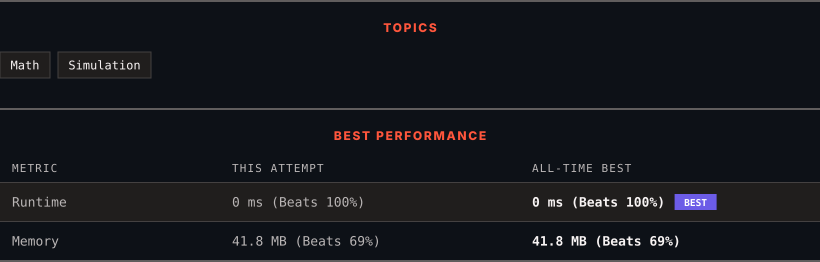

<div align="center">

# 2169. Count Operations to Obtain Zero

      

[](https://leetcode.com/problems/count-operations-to-obtain-zero/)

</div>

---

<div align="center">

<picture>
  <source media="(prefers-color-scheme: dark)" srcset="panel-dark.svg">
  <source media="(prefers-color-scheme: light)" srcset="panel-light.svg">
  
</picture>

</div>

> **New personal best** — Runtime improved on this submission.

### HOW IT WENT

| | |
|:--|:--|
| **Attempts** | 2 before accepted |
| **Time to solve** | under a minute |
| **Verdicts** | ✅ Accepted → ✅ Accepted |

---

### NOTES

_No notes yet._

---

### SOLUTIONS (2)

| # | File | Language | Date |
|:-:|------|:--------:|:----:|
| 1 | [sol1.java](./sol1.java) | `Java` | 2026-11-23 |
| 2 | [sol2.java](./sol2.java) | `Java` | 2026-11-23 ← **latest** |

---

### PROBLEM DESCRIPTION

You are given two **non-negative** integers `num1` and `num2`.

In one **operation**, if `num1 >= num2`, you must subtract `num2` from `num1`, otherwise subtract `num1` from `num2`.

	- For example, if `num1 = 5` and `num2 = 4`, subtract `num2` from `num1`, thus obtaining `num1 = 1` and `num2 = 4`. However, if `num1 = 4` and `num2 = 5`, after one operation, `num1 = 4` and `num2 = 1`.

Return *the **number of operations** required to make either* `num1 = 0` *or* `num2 = 0`.

 

**Example 1:**

```

**Input:** num1 = 2, num2 = 3
**Output:** 3
**Explanation:** 
- Operation 1: num1 = 2, num2 = 3. Since num1 < num2, we subtract num1 from num2 and get num1 = 2, num2 = 3 - 2 = 1.
- Operation 2: num1 = 2, num2 = 1. Since num1 > num2, we subtract num2 from num1.
- Operation 3: num1 = 1, num2 = 1. Since num1 == num2, we subtract num2 from num1.
Now num1 = 0 and num2 = 1. Since num1 == 0, we do not need to perform any further operations.
So the total number of operations required is 3.

```

**Example 2:**

```

**Input:** num1 = 10, num2 = 10
**Output:** 1
**Explanation:** 
- Operation 1: num1 = 10, num2 = 10. Since num1 == num2, we subtract num2 from num1 and get num1 = 10 - 10 = 0.
Now num1 = 0 and num2 = 10. Since num1 == 0, we are done.
So the total number of operations required is 1.

```

 

**Constraints:**

	- `0 <= num1, num2 <= 10^5`

---

<div align="center">

<sub>Auto-synced by <strong>LeetSync</strong> · Built by <a href="https://deveshsamant.in/">Devesh Samant</a></sub>

</div>
