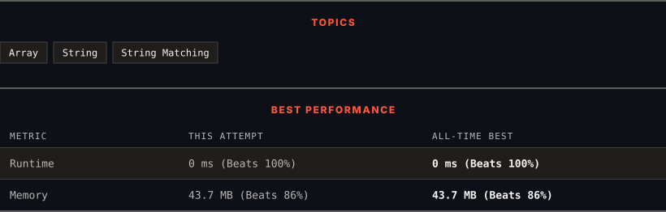

<div align="center">

# 2185. Counting Words With a Given Prefix

      

[](https://leetcode.com/problems/counting-words-with-a-given-prefix/)

</div>

---

<div align="center">

<picture>
  <source media="(prefers-color-scheme: dark)" srcset="panel-dark.svg">
  <source media="(prefers-color-scheme: light)" srcset="panel-light.svg">
  
</picture>

</div>

### HOW IT WENT

| | |
|:--|:--|
| **Attempts** | 2 before accepted |
| **Time to solve** | 1 min |
| **Verdicts** | ✅ Accepted → ✅ Accepted |

---

### NOTES

_No notes yet._

---

### SOLUTIONS (2)

| # | File | Language | Date |
|:-:|------|:--------:|:----:|
| 1 | [sol1.java](./sol1.java) | `Java` | 2026-11-23 |
| 2 | [sol2.java](./sol2.java) | `Java` | 2026-11-23 ← **latest** |

---

### PROBLEM DESCRIPTION

You are given an array of strings `words` and a string `pref`.

Return *the number of strings in *`words`* that contain *`pref`* as a **prefix***.

A **prefix** of a string `s` is any leading contiguous substring of `s`.

 

**Example 1:**

```

**Input:** words = ["pay","**at**tention","practice","**at**tend"], `pref `= "at"
**Output:** 2
**Explanation:** The 2 strings that contain "at" as a prefix are: "**at**tention" and "**at**tend".

```

**Example 2:**

```

**Input:** words = ["leetcode","win","loops","success"], `pref `= "code"
**Output:** 0
**Explanation:** There are no strings that contain "code" as a prefix.

```

 

**Constraints:**

	- `1 <= words.length <= 100`

	- `1 <= words[i].length, pref.length <= 100`

	- `words[i]` and `pref` consist of lowercase English letters.

---

<div align="center">

<sub>Auto-synced by <strong>LeetSync</strong> · Built by <a href="https://deveshsamant.in/">Devesh Samant</a></sub>

</div>
