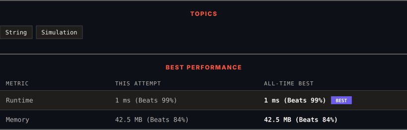

<div align="center">

# 2243. Calculate Digit Sum of a String

      

[](https://leetcode.com/problems/calculate-digit-sum-of-a-string/)

</div>

---

<div align="center">

<picture>
  <source media="(prefers-color-scheme: dark)" srcset="panel-dark.svg">
  <source media="(prefers-color-scheme: light)" srcset="panel-light.svg">
  
</picture>

</div>

> **New personal best** — Runtime improved on this submission.

### HOW IT WENT

| | |
|:--|:--|
| **Attempts** | first try |
| **Time to solve** | 5 min |
| **Verdicts** | ✅ Accepted |

---

### NOTES

_No notes yet._

---

### SOLUTIONS (1)

| # | File | Language | Date |
|:-:|------|:--------:|:----:|
| 1 | [sol1.java](./sol1.java) | `Java` | 2026-11-16 ← **latest** |

---

### PROBLEM DESCRIPTION

You are given a string `s` consisting of digits and an integer `k`.

A **round** can be completed if the length of `s` is greater than `k`. In one round, do the following:

	- **Divide** `s` into **consecutive groups** of size `k` such that the first `k` characters are in the first group, the next `k` characters are in the second group, and so on. **Note** that the size of the last group can be smaller than `k`.

	- **Replace** each group of `s` with a string representing the sum of all its digits. For example, `"346"` is replaced with `"13"` because `3 + 4 + 6 = 13`.

	- **Merge** consecutive groups together to form a new string. If the length of the string is greater than `k`, repeat from step `1`.

Return `s` *after all rounds have been completed*.

 

**Example 1:**

```

**Input:** s = "11111222223", k = 3
**Output:** "135"
**Explanation:** 
- For the first round, we divide s into groups of size 3: "111", "112", "222", and "23".
  ​​​​​Then we calculate the digit sum of each group: 1 + 1 + 1 = 3, 1 + 1 + 2 = 4, 2 + 2 + 2 = 6, and 2 + 3 = 5. 
  So, s becomes "3" + "4" + "6" + "5" = "3465" after the first round.
- For the second round, we divide s into "346" and "5".
  Then we calculate the digit sum of each group: 3 + 4 + 6 = 13, 5 = 5. 
  So, s becomes "13" + "5" = "135" after second round. 
Now, s.length <= k, so we return "135" as the answer.

```

**Example 2:**

```

**Input:** s = "00000000", k = 3
**Output:** "000"
**Explanation:** 
We divide s into "000", "000", and "00".
Then we calculate the digit sum of each group: 0 + 0 + 0 = 0, 0 + 0 + 0 = 0, and 0 + 0 = 0. 
s becomes "0" + "0" + "0" = "000", whose length is equal to k, so we return "000".

```

 

**Constraints:**

	- `1 <= s.length <= 100`

	- `2 <= k <= 100`

	- `s` consists of digits only.

---

<div align="center">

<sub>Auto-synced by <strong>LeetSync</strong> · Built by <a href="https://deveshsamant.in/">Devesh Samant</a></sub>

</div>
