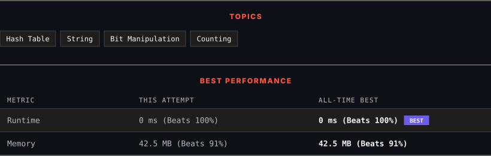

<div align="center">

# 2351. First Letter to Appear Twice

      

[](https://leetcode.com/problems/first-letter-to-appear-twice/)

</div>

---

<div align="center">

<picture>
  <source media="(prefers-color-scheme: dark)" srcset="panel-dark.svg">
  <source media="(prefers-color-scheme: light)" srcset="panel-light.svg">
  
</picture>

</div>

> **New personal best** — Runtime improved on this submission.

### HOW IT WENT

| | |
|:--|:--|
| **Attempts** | first try |
| **Time to solve** | 35 min |
| **Verdicts** | ✅ Accepted |

---

### NOTES

_No notes yet._

---

### SOLUTIONS (1)

| # | File | Language | Date |
|:-:|------|:--------:|:----:|
| 1 | [sol1.java](./sol1.java) | `Java` | 2026-10-24 ← **latest** |

---

### PROBLEM DESCRIPTION

Given a string `s` consisting of lowercase English letters, return *the first letter to appear **twice***.

**Note**:

	- A letter `a` appears twice before another letter `b` if the **second** occurrence of `a` is before the **second** occurrence of `b`.

	- `s` will contain at least one letter that appears twice.

 

**Example 1:**

```

**Input:** s = "abccbaacz"
**Output:** "c"
**Explanation:**
The letter 'a' appears on the indexes 0, 5 and 6.
The letter 'b' appears on the indexes 1 and 4.
The letter 'c' appears on the indexes 2, 3 and 7.
The letter 'z' appears on the index 8.
The letter 'c' is the first letter to appear twice, because out of all the letters the index of its second occurrence is the smallest.

```

**Example 2:**

```

**Input:** s = "abcdd"
**Output:** "d"
**Explanation:**
The only letter that appears twice is 'd' so we return 'd'.

```

 

**Constraints:**

	- `2 <= s.length <= 100`

	- `s` consists of lowercase English letters.

	- `s` has at least one repeated letter.

---

<div align="center">

<sub>Auto-synced by <strong>LeetSync</strong> · Built by <a href="https://deveshsamant.in/">Devesh Samant</a></sub>

</div>
