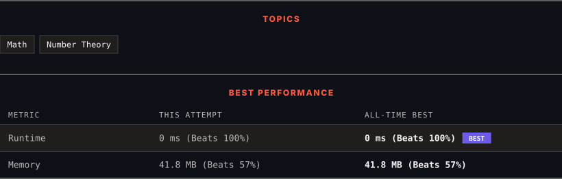

<div align="center">

# 2413. Smallest Even Multiple

      

[](https://leetcode.com/problems/smallest-even-multiple/)

</div>

---

<div align="center">

<picture>
  <source media="(prefers-color-scheme: dark)" srcset="panel-dark.svg">
  <source media="(prefers-color-scheme: light)" srcset="panel-light.svg">
  
</picture>

</div>

> **New personal best** — Runtime improved on this submission.

### HOW IT WENT

| | |
|:--|:--|
| **Attempts** | first try |
| **Time to solve** | under a minute |
| **Verdicts** | ✅ Accepted |

---

### NOTES

_No notes yet._

---

### SOLUTIONS (1)

| # | File | Language | Date |
|:-:|------|:--------:|:----:|
| 1 | [sol1.java](./sol1.java) | `Java` | 2026-11-23 ← **latest** |

---

### PROBLEM DESCRIPTION

Given a **positive** integer `n`, return *the smallest positive integer that is a multiple of **both** *`2`* and *`n`.
 

**Example 1:**

```

**Input:** n = 5
**Output:** 10
**Explanation:** The smallest multiple of both 5 and 2 is 10.

```

**Example 2:**

```

**Input:** n = 6
**Output:** 6
**Explanation:** The smallest multiple of both 6 and 2 is 6. Note that a number is a multiple of itself.

```

 

**Constraints:**

	- `1 <= n <= 150`

---

<div align="center">

<sub>Auto-synced by <strong>LeetSync</strong> · Built by <a href="https://deveshsamant.in/">Devesh Samant</a></sub>

</div>
