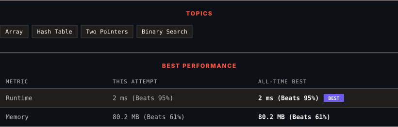

<div align="center">

# 2540. Minimum Common Value

      

[](https://leetcode.com/problems/minimum-common-value/)

</div>

---

<div align="center">

<picture>
  <source media="(prefers-color-scheme: dark)" srcset="panel-dark.svg">
  <source media="(prefers-color-scheme: light)" srcset="panel-light.svg">
  
</picture>

</div>

> **New personal best** — Runtime improved on this submission.

### HOW IT WENT

| | |
|:--|:--|
| **Attempts** | first try |
| **Time to solve** | under a minute |
| **Verdicts** | ✅ Accepted |

---

### NOTES

_No notes yet._

---

### SOLUTIONS (1)

| # | File | Language | Date |
|:-:|------|:--------:|:----:|
| 1 | [sol1.java](./sol1.java) | `Java` | 2026-11-28 ← **latest** |

---

### PROBLEM DESCRIPTION

Given two integer arrays `nums1` and `nums2`, sorted in non-decreasing order, return *the **minimum integer common** to both arrays*. If there is no common integer amongst `nums1` and `nums2`, return `-1`.

Note that an integer is said to be **common** to `nums1` and `nums2` if both arrays have **at least one** occurrence of that integer.

 

**Example 1:**

```

**Input:** nums1 = [1,2,3], nums2 = [2,4]
**Output:** 2
**Explanation:** The smallest element common to both arrays is 2, so we return 2.

```

**Example 2:**

```

**Input:** nums1 = [1,2,3,6], nums2 = [2,3,4,5]
**Output:** 2
**Explanation:** There are two common elements in the array 2 and 3 out of which 2 is the smallest, so 2 is returned.

```

 

**Constraints:**

	- `1 <= nums1.length, nums2.length <= 10^5`

	- `1 <= nums1[i], nums2[j] <= 10^9`

	- Both `nums1` and `nums2` are sorted in **non-decreasing** order.

---

<div align="center">

<sub>Auto-synced by <strong>LeetSync</strong> · Built by <a href="https://deveshsamant.in/">Devesh Samant</a></sub>

</div>
