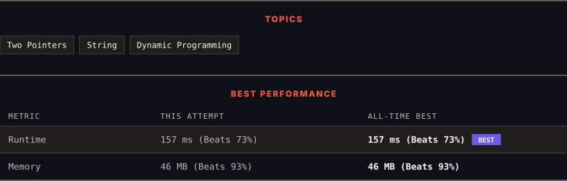

# 2911. Minimum Changes to Make K Semi-palindromes

      

---

<picture>
  <source media="(prefers-color-scheme: dark)" srcset="panel-dark.svg">
  <source media="(prefers-color-scheme: light)" srcset="panel-light.svg">
  
</picture>

> **New personal best** — Runtime improved on this submission.

### HOW IT WENT

| | |
|:--|:--|
| **Attempts** | first try |
| **Time to solve** | 3 min |
| **Verdicts** | ✅ Accepted |

---

### NOTES

_No notes yet._

---

### SOLUTIONS (1)

| # | File | Language | Date |
|:-:|------|:--------:|:----:|
| 1 | [sol1.java](./sol1.java) | `Java` | 2026-11-17 ← **latest** |

---

### PROBLEM DESCRIPTION

Given a string `s` and an integer `k`, partition `s` into `k` **substrings** such that the letter changes needed to make each substring a **semi-palindrome** are minimized.

Return the ***minimum** number of letter changes* required*.*

A **semi-palindrome** is a special type of string that can be divided into **palindromes** based on a repeating pattern. To check if a string is a semi-palindrome:​

	- Choose a positive divisor `d` of the string's length. `d` can range from `1` up to, but not including, the string's length. For a string of length `1`, it does not have a valid divisor as per this definition, since the only divisor is its length, which is not allowed.

	- For a given divisor `d`, divide the string into groups where each group contains characters from the string that follow a repeating pattern of length `d`. Specifically, the first group consists of characters at positions `1`, `1 + d`, `1 + 2d`, and so on; the second group includes characters at positions `2`, `2 + d`, `2 + 2d`, etc.

	- The string is considered a semi-palindrome if each of these groups forms a palindrome.

Consider the string `"abcabc"`:

	- The length of `"abcabc"` is `6`. Valid divisors are `1`, `2`, and `3`.

	- For `d = 1`: The entire string `"abcabc"` forms one group. Not a palindrome.

	- For `d = 2`:
	

		Group 1 (positions `1, 3, 5`): `"acb"`

		- Group 2 (positions `2, 4, 6`): `"bac"`

		- Neither group forms a palindrome.

	

	
	- For `d = 3`:
	

		Group 1 (positions `1, 4`): `"aa"`

		- Group 2 (positions `2, 5`): `"bb"`

		- Group 3 (positions `3, 6`): `"cc"`

		- All groups form palindromes. Therefore, `"abcabc"` is a semi-palindrome.

	

	

 

**Example 1: **

**Input: **  s = "abcac", k = 2 

**Output: **  1 

**Explanation: ** Divide `s` into `"ab"` and `"cac"`. `"cac"` is already semi-palindrome. Change `"ab"` to `"aa"`, it becomes semi-palindrome with `d = 1`.

**Example 2: **

**Input: **  s = "abcdef", k = 2 

**Output: **  2 

**Explanation: ** Divide `s` into substrings `"abc"` and `"def"`. Each needs one change to become semi-palindrome.

**Example 3: **

**Input: **  s = "aabbaa", k = 3 

**Output: **  0 

**Explanation: ** Divide `s` into substrings `"aa"`, `"bb"` and `"aa"`. All are already semi-palindromes.

 

**Constraints:**

	- `2 <= s.length <= 200`

	- `1 <= k <= s.length / 2`

	- `s` contains only lowercase English letters.

---

Auto-synced by <strong>LeetSync</strong> · Built by <a href="https://deveshsamant.in/">Devesh Samant</a>

