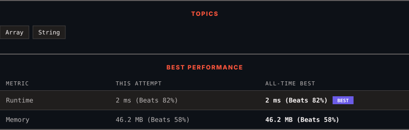

<div align="center">

# 2942. Find Words Containing Character

      

[](https://leetcode.com/problems/find-words-containing-character/)

</div>

---

<div align="center">

<picture>
  <source media="(prefers-color-scheme: dark)" srcset="panel-dark.svg">
  <source media="(prefers-color-scheme: light)" srcset="panel-light.svg">
  
</picture>

</div>

> **New personal best** — Runtime improved on this submission.

### HOW IT WENT

| | |
|:--|:--|
| **Attempts** | first try |
| **Time to solve** | 7 min |
| **Verdicts** | ✅ Accepted |

---

### NOTES

_No notes yet._

---

### SOLUTIONS (1)

| # | File | Language | Date |
|:-:|------|:--------:|:----:|
| 1 | [sol1.java](./sol1.java) | `Java` | 2026-11-24 ← **latest** |

---

### PROBLEM DESCRIPTION

You are given a **0-indexed** array of strings `words` and a character `x`.

Return *an **array of indices** representing the words that contain the character *`x`.

**Note** that the returned array may be in **any** order.

 

**Example 1:**

```

**Input:** words = ["leet","code"], x = "e"
**Output:** [0,1]
**Explanation:** "e" occurs in both words: "l**ee**t", and "cod**e**". Hence, we return indices 0 and 1.

```

**Example 2:**

```

**Input:** words = ["abc","bcd","aaaa","cbc"], x = "a"
**Output:** [0,2]
**Explanation:** "a" occurs in "**a**bc", and "**aaaa**". Hence, we return indices 0 and 2.

```

**Example 3:**

```

**Input:** words = ["abc","bcd","aaaa","cbc"], x = "z"
**Output:** []
**Explanation:** "z" does not occur in any of the words. Hence, we return an empty array.

```

 

**Constraints:**

	- `1 <= words.length <= 50`

	- `1 <= words[i].length <= 50`

	- `x` is a lowercase English letter.

	- `words[i]` consists only of lowercase English letters.

---

<div align="center">

<sub>Auto-synced by <strong>LeetSync</strong> · Built by <a href="https://deveshsamant.in/">Devesh Samant</a></sub>

</div>
