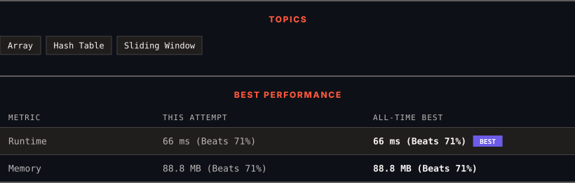

<div align="center">

# 2958. Length of Longest Subarray With at Most K Frequency

      

[](https://leetcode.com/problems/length-of-longest-subarray-with-at-most-k-frequency/)

</div>

---

<div align="center">

<picture>
  <source media="(prefers-color-scheme: dark)" srcset="panel-dark.svg">
  <source media="(prefers-color-scheme: light)" srcset="panel-light.svg">
  
</picture>

</div>

> **New personal best** — Runtime improved on this submission.

### HOW IT WENT

| | |
|:--|:--|
| **Attempts** | first try |
| **Time to solve** | 105 h 24 min |
| **Verdicts** | ✅ Accepted |

---

### NOTES

_No notes yet._

---

### SOLUTIONS (1)

| # | File | Language | Date |
|:-:|------|:--------:|:----:|
| 1 | [sol1.java](./sol1.java) | `Java` | 2026-10-11 ← **latest** |

---

### PROBLEM DESCRIPTION

You are given an integer array `nums` and an integer `k`.

The **frequency** of an element `x` is the number of times it occurs in an array.

An array is called **good** if the frequency of each element in this array is **less than or equal** to `k`.

Return *the length of the **longest** **good** subarray of* `nums`*.*

A **subarray** is a contiguous non-empty sequence of elements within an array.

 

**Example 1:**

```

**Input:** nums = [1,2,3,1,2,3,1,2], k = 2
**Output:** 6
**Explanation:** The longest possible good subarray is [1,2,3,1,2,3] since the values 1, 2, and 3 occur at most twice in this subarray. Note that the subarrays [2,3,1,2,3,1] and [3,1,2,3,1,2] are also good.
It can be shown that there are no good subarrays with length more than 6.

```

**Example 2:**

```

**Input:** nums = [1,2,1,2,1,2,1,2], k = 1
**Output:** 2
**Explanation:** The longest possible good subarray is [1,2] since the values 1 and 2 occur at most once in this subarray. Note that the subarray [2,1] is also good.
It can be shown that there are no good subarrays with length more than 2.

```

**Example 3:**

```

**Input:** nums = [5,5,5,5,5,5,5], k = 4
**Output:** 4
**Explanation:** The longest possible good subarray is [5,5,5,5] since the value 5 occurs 4 times in this subarray.
It can be shown that there are no good subarrays with length more than 4.

```

 

**Constraints:**

	- `1 <= nums.length <= 10^5`

	- `1 <= nums[i] <= 10^9`

	- `1 <= k <= nums.length`

---

<div align="center">

<sub>Auto-synced by <strong>LeetSync</strong> · Built by <a href="https://deveshsamant.in/">Devesh Samant</a></sub>

</div>
