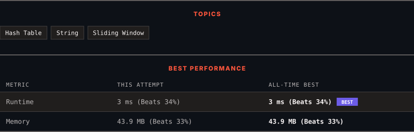

# 3090. Maximum Length Substring With Two Occurrences

      

---

<picture>
  <source media="(prefers-color-scheme: dark)" srcset="panel-dark.svg">
  <source media="(prefers-color-scheme: light)" srcset="panel-light.svg">
  
</picture>

> **New personal best** — Runtime improved on this submission.

### HOW IT WENT

| | |
|:--|:--|
| **Attempts** | first try |
| **Time to solve** | 103 h 48 min |
| **Verdicts** | ✅ Accepted |

---

### NOTES

_No notes yet._

---

### SOLUTIONS (1)

| # | File | Language | Date |
|:-:|------|:--------:|:----:|
| 1 | [sol1.java](./sol1.java) | `Java` | 2026-10-11 ← **latest** |

---

### PROBLEM DESCRIPTION

Given a string `s`, return the **maximum** length of a substring such that it contains *at most two occurrences* of each character.
 

**Example 1:**

**Input:** s = "bcbbbcba"

**Output:** 4

**Explanation:**

The following substring has a length of 4 and contains at most two occurrences of each character: `"bcbbbcba"`.

**Example 2:**

**Input:** s = "aaaa"

**Output:** 2

**Explanation:**

The following substring has a length of 2 and contains at most two occurrences of each character: `"aaaa"`.

 

**Constraints:**

	- `2 <= s.length <= 100`

	- `s` consists only of lowercase English letters.

---

Auto-synced by <strong>LeetSync</strong> · Built by <a href="https://deveshsamant.in/">Devesh Samant</a>

