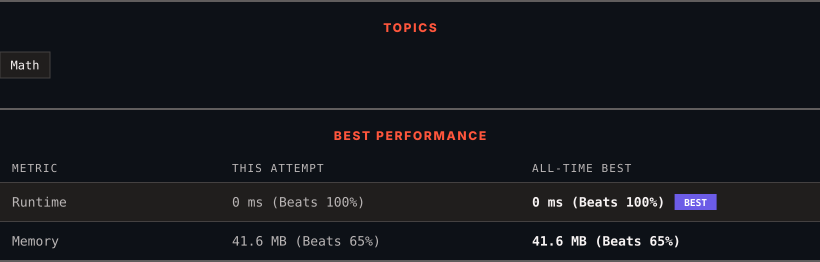

# 3099. Harshad Number

      

---

<picture>
  <source media="(prefers-color-scheme: dark)" srcset="panel-dark.svg">
  <source media="(prefers-color-scheme: light)" srcset="panel-light.svg">
  
</picture>

> **New personal best** — Runtime improved on this submission.

### HOW IT WENT

| | |
|:--|:--|
| **Attempts** | first try |
| **Time to solve** | under a minute |
| **Verdicts** | ✅ Accepted |

---

### NOTES

_No notes yet._

---

### SOLUTIONS (1)

| # | File | Language | Date |
|:-:|------|:--------:|:----:|
| 1 | [sol1.java](./sol1.java) | `Java` | 2026-11-24 ← **latest** |

---

### PROBLEM DESCRIPTION

An integer divisible by the **sum** of its digits is said to be a **Harshad** number. You are given an integer `x`. Return* the sum of the digits *of* *`x`* *if* *`x`* *is a **Harshad** number, otherwise, return* *`-1`*.*

 

**Example 1:**

**Input:** x = 18

**Output:** 9

**Explanation:**

The sum of digits of `x` is `9`. `18` is divisible by `9`. So `18` is a Harshad number and the answer is `9`.

**Example 2:**

**Input:** x = 23

**Output:** -1

**Explanation:**

The sum of digits of `x` is `5`. `23` is not divisible by `5`. So `23` is not a Harshad number and the answer is `-1`.

 

**Constraints:**

	- `1 <= x <= 100`

---

Auto-synced by <strong>LeetSync</strong> · Built by <a href="https://deveshsamant.in/">Devesh Samant</a>

