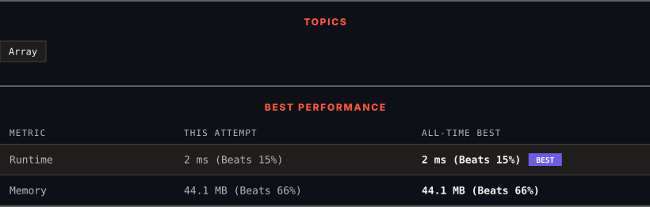

# 3105. Longest Strictly Increasing or Strictly Decreasing Subarray

      

---

<picture>
  <source media="(prefers-color-scheme: dark)" srcset="panel-dark.svg">
  <source media="(prefers-color-scheme: light)" srcset="panel-light.svg">
  
</picture>

> **New personal best** — Runtime improved on this submission.

### HOW IT WENT

| | |
|:--|:--|
| **Attempts** | first try |
| **Time to solve** | 1 min |
| **Verdicts** | ✅ Accepted |

---

### NOTES

_No notes yet._

---

### SOLUTIONS (1)

| # | File | Language | Date |
|:-:|------|:--------:|:----:|
| 1 | [sol1.java](./sol1.java) | `Java` | 2026-11-12 ← **latest** |

---

### PROBLEM DESCRIPTION

You are given an array of integers `nums`. Return *the length of the **longest** subarray of *`nums`* which is either **strictly increasing** or **strictly decreasing***.

 

**Example 1:**

**Input:** nums = [1,4,3,3,2]

**Output:** 2

**Explanation:**

The strictly increasing subarrays of `nums` are `[1]`, `[2]`, `[3]`, `[3]`, `[4]`, and `[1,4]`.

The strictly decreasing subarrays of `nums` are `[1]`, `[2]`, `[3]`, `[3]`, `[4]`, `[3,2]`, and `[4,3]`.

Hence, we return `2`.

**Example 2:**

**Input:** nums = [3,3,3,3]

**Output:** 1

**Explanation:**

The strictly increasing subarrays of `nums` are `[3]`, `[3]`, `[3]`, and `[3]`.

The strictly decreasing subarrays of `nums` are `[3]`, `[3]`, `[3]`, and `[3]`.

Hence, we return `1`.

**Example 3:**

**Input:** nums = [3,2,1]

**Output:** 3

**Explanation:**

The strictly increasing subarrays of `nums` are `[3]`, `[2]`, and `[1]`.

The strictly decreasing subarrays of `nums` are `[3]`, `[2]`, `[1]`, `[3,2]`, `[2,1]`, and `[3,2,1]`.

Hence, we return `3`.

 

**Constraints:**

	- `1 <= nums.length <= 50`

	- `1 <= nums[i] <= 50`

---

Auto-synced by <strong>LeetSync</strong> · Built by <a href="https://deveshsamant.in/">Devesh Samant</a>

