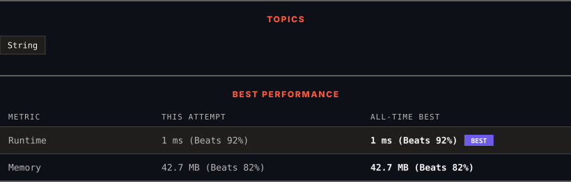

# 3330. Find the Original Typed String I

      

---

<picture>
  <source media="(prefers-color-scheme: dark)" srcset="panel-dark.svg">
  <source media="(prefers-color-scheme: light)" srcset="panel-light.svg">
  
</picture>

> **New personal best** — Runtime improved on this submission.

### HOW IT WENT

| | |
|:--|:--|
| **Attempts** | first try |
| **Time to solve** | under a minute |
| **Verdicts** | ✅ Accepted |

---

### NOTES

_No notes yet._

---

### SOLUTIONS (1)

| # | File | Language | Date |
|:-:|------|:--------:|:----:|
| 1 | [sol1.java](./sol1.java) | `Java` | 2026-11-24 ← **latest** |

---

### PROBLEM DESCRIPTION

Alice is attempting to type a specific string on her computer. However, she tends to be clumsy and **may** press a key for too long, resulting in a character being typed **multiple** times.

Although Alice tried to focus on her typing, she is aware that she may still have done this **at most** *once*.

You are given a string `word`, which represents the **final** output displayed on Alice's screen.

Return the total number of *possible* original strings that Alice *might* have intended to type.

 

**Example 1:**

**Input:** word = "abbcccc"

**Output:** 5

**Explanation:**

The possible strings are: `"abbcccc"`, `"abbccc"`, `"abbcc"`, `"abbc"`, and `"abcccc"`.

**Example 2:**

**Input:** word = "abcd"

**Output:** 1

**Explanation:**

The only possible string is `"abcd"`.

**Example 3:**

**Input:** word = "aaaa"

**Output:** 4

 

**Constraints:**

	- `1 <= word.length <= 100`

	- `word` consists only of lowercase English letters.

---

Auto-synced by <strong>LeetSync</strong> · Built by <a href="https://deveshsamant.in/">Devesh Samant</a>

