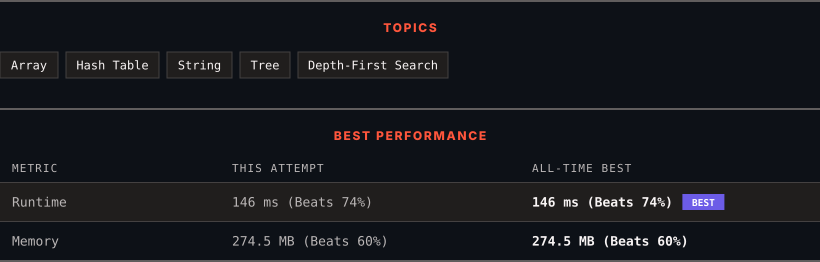

# 3331. Find Subtree Sizes After Changes

      

---

<picture>
  <source media="(prefers-color-scheme: dark)" srcset="panel-dark.svg">
  <source media="(prefers-color-scheme: light)" srcset="panel-light.svg">
  
</picture>

> **New personal best** — Runtime improved on this submission.

### HOW IT WENT

| | |
|:--|:--|
| **Attempts** | first try |
| **Time to solve** | 2 min |
| **Verdicts** | ✅ Accepted |

---

### NOTES

_No notes yet._

---

### SOLUTIONS (1)

| # | File | Language | Date |
|:-:|------|:--------:|:----:|
| 1 | [sol1.java](./sol1.java) | `Java` | 2026-11-21 ← **latest** |

---

### PROBLEM DESCRIPTION

You are given a tree rooted at node 0 that consists of `n` nodes numbered from `0` to `n - 1`. The tree is represented by an array `parent` of size `n`, where `parent[i]` is the parent of node `i`. Since node 0 is the root, `parent[0] == -1`.

You are also given a string `s` of length `n`, where `s[i]` is the character assigned to node `i`.

We make the following changes on the tree **one** time **simultaneously** for all nodes `x` from `1` to `n - 1`:

	- Find the **closest** node `y` to node `x` such that `y` is an ancestor of `x`, and `s[x] == s[y]`.

	- If node `y` does not exist, do nothing.

	- Otherwise, **remove** the edge between `x` and its current parent and make node `y` the new parent of `x` by adding an edge between them.

Return an array `answer` of size `n` where `answer[i]` is the **size** of the subtree rooted at node `i` in the **final** tree.

 

**Example 1:**

**Input:** parent = [-1,0,0,1,1,1], s = "abaabc"

**Output:** [6,3,1,1,1,1]

**Explanation:**

The parent of node 3 will change from node 1 to node 0.

**Example 2:**

**Input:** parent = [-1,0,4,0,1], s = "abbba"

**Output:** [5,2,1,1,1]

**Explanation:**

The following changes will happen at the same time:

	- The parent of node 4 will change from node 1 to node 0.

	- The parent of node 2 will change from node 4 to node 1.

 

**Constraints:**

	- `n == parent.length == s.length`

	- `1 <= n <= 10^5`

	- `0 <= parent[i] <= n - 1` for all `i >= 1`.

	- `parent[0] == -1`

	- `parent` represents a valid tree.

	- `s` consists only of lowercase English letters.

---

Auto-synced by <strong>LeetSync</strong> · Built by <a href="https://deveshsamant.in/">Devesh Samant</a>

