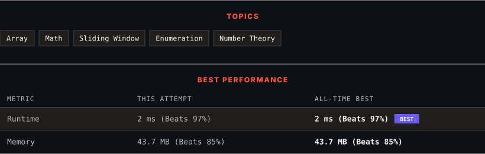

# 3411. Maximum Subarray With Equal Products

      

---

<picture>
  <source media="(prefers-color-scheme: dark)" srcset="panel-dark.svg">
  <source media="(prefers-color-scheme: light)" srcset="panel-light.svg">
  
</picture>

> **New personal best** — Runtime improved on this submission.

### HOW IT WENT

| | |
|:--|:--|
| **Attempts** | first try |
| **Time to solve** | 1 h 18 min |
| **Verdicts** | ✅ Accepted |

---

### NOTES

_No notes yet._

---

### SOLUTIONS (1)

| # | File | Language | Date |
|:-:|------|:--------:|:----:|
| 1 | [sol1.java](./sol1.java) | `Java` | 2026-11-24 ← **latest** |

---

### PROBLEM DESCRIPTION

You are given an array of **positive** integers `nums`.

An array `arr` is called **product equivalent** if `prod(arr) == lcm(arr) * gcd(arr)`, where:

	- `prod(arr)` is the product of all elements of `arr`.

	- `gcd(arr)` is the GCD of all elements of `arr`.

	- `lcm(arr)` is the LCM of all elements of `arr`.

Return the length of the **longest** **product equivalent** subarray of `nums`.

 

**Example 1:**

**Input:** nums = [1,2,1,2,1,1,1]

**Output:** 5

**Explanation:** 

The longest product equivalent subarray is `[1, 2, 1, 1, 1]`, where `prod([1, 2, 1, 1, 1]) = 2`, `gcd([1, 2, 1, 1, 1]) = 1`, and `lcm([1, 2, 1, 1, 1]) = 2`.

**Example 2:**

**Input:** nums = [2,3,4,5,6]

**Output:** 3

**Explanation:** 

The longest product equivalent subarray is `[3, 4, 5].`

**Example 3:**

**Input:** nums = [1,2,3,1,4,5,1]

**Output:** 5

 

**Constraints:**

	- `2 <= nums.length <= 100`

	- `1 <= nums[i] <= 10`

---

Auto-synced by <strong>LeetSync</strong> · Built by <a href="https://deveshsamant.in/">Devesh Samant</a>

