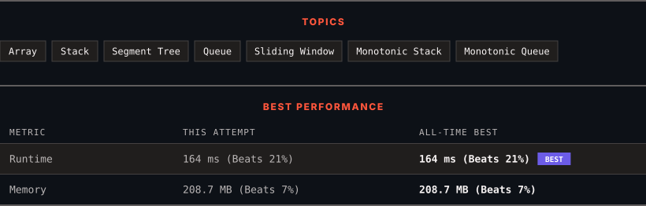

# 3420. Count Non-Decreasing Subarrays After K Operations

      

---

<picture>
  <source media="(prefers-color-scheme: dark)" srcset="panel-dark.svg">
  <source media="(prefers-color-scheme: light)" srcset="panel-light.svg">
  
</picture>

> **New personal best** — Runtime improved on this submission.

### HOW IT WENT

| | |
|:--|:--|
| **Attempts** | first try |
| **Time to solve** | 3 min |
| **Verdicts** | ✅ Accepted |

---

### NOTES

_No notes yet._

---

### SOLUTIONS (1)

| # | File | Language | Date |
|:-:|------|:--------:|:----:|
| 1 | [sol1.java](./sol1.java) | `Java` | 2026-11-13 ← **latest** |

---

### PROBLEM DESCRIPTION

You are given an array `nums` of `n` integers and an integer `k`.

For each subarray of `nums`, you can apply **up to** `k` operations on it. In each operation, you increment any element of the subarray by 1.

**Note** that each subarray is considered independently, meaning changes made to one subarray do not persist to another.

Return the number of subarrays that you can make **non-decreasing** ​​​​​after performing at most `k` operations.

An array is said to be **non-decreasing** if each element is greater than or equal to its previous element, if it exists.

 

**Example 1:**

**Input:** nums = [6,3,1,2,4,4], k = 7

**Output:** 17

**Explanation:**

Out of all 21 possible subarrays of `nums`, only the subarrays `[6, 3, 1]`, `[6, 3, 1, 2]`, `[6, 3, 1, 2, 4]` and `[6, 3, 1, 2, 4, 4]` cannot be made non-decreasing after applying up to k = 7 operations. Thus, the number of non-decreasing subarrays is `21 - 4 = 17`.

**Example 2:**

**Input:** nums = [6,3,1,3,6], k = 4

**Output:** 12

**Explanation:**

The subarray `[3, 1, 3, 6]` along with all subarrays of `nums` with three or fewer elements, except `[6, 3, 1]`, can be made non-decreasing after `k` operations. There are 5 subarrays of a single element, 4 subarrays of two elements, and 2 subarrays of three elements except `[6, 3, 1]`, so there are `1 + 5 + 4 + 2 = 12` subarrays that can be made non-decreasing.

 

**Constraints:**

	- `1 <= nums.length <= 10^5`

	- `1 <= nums[i] <= 10^9`

	- `1 <= k <= 10^9`

---

Auto-synced by <strong>LeetSync</strong> · Built by <a href="https://deveshsamant.in/">Devesh Samant</a>

