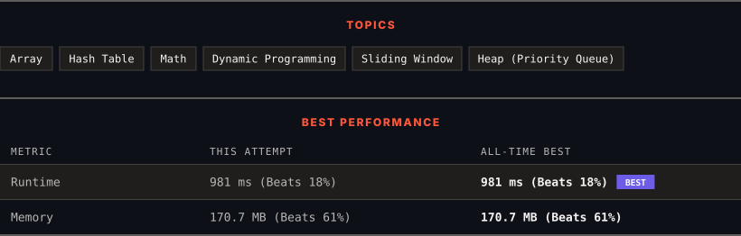

# 3505. Minimum Operations to Make Elements Within K Subarrays Equal

      

---

<picture>
  <source media="(prefers-color-scheme: dark)" srcset="panel-dark.svg">
  <source media="(prefers-color-scheme: light)" srcset="panel-light.svg">
  
</picture>

> **New personal best** — Runtime improved on this submission.

### HOW IT WENT

| | |
|:--|:--|
| **Attempts** | first try |
| **Time to solve** | 2 min |
| **Verdicts** | ✅ Accepted |

---

### NOTES

_No notes yet._

---

### SOLUTIONS (1)

| # | File | Language | Date |
|:-:|------|:--------:|:----:|
| 1 | [sol1.java](./sol1.java) | `Java` | 2026-11-04 ← **latest** |

---

### PROBLEM DESCRIPTION

You are given an integer array `nums` and two integers, `x` and `k`. You can perform the following operation any number of times (**including zero**):

	- Increase or decrease any element of `nums` by 1.

Return the **minimum** number of operations needed to have **at least** `k` *non-overlapping subarrays* of size **exactly** `x` in `nums`, where all elements within each subarray are equal.

 

**Example 1:**

**Input:** nums = [5,-2,1,3,7,3,6,4,-1], x = 3, k = 2

**Output:** 8

**Explanation:**

	- Use 3 operations to add 3 to `nums[1]` and use 2 operations to subtract 2 from `nums[3]`. The resulting array is `[5, 1, 1, 1, 7, 3, 6, 4, -1]`.

	- Use 1 operation to add 1 to `nums[5]` and use 2 operations to subtract 2 from `nums[6]`. The resulting array is `[5, 1, 1, 1, 7, 4, 4, 4, -1]`.

	- Now, all elements within each subarray `[1, 1, 1]` (from indices 1 to 3) and `[4, 4, 4]` (from indices 5 to 7) are equal. Since 8 total operations were used, 8 is the output.

**Example 2:**

**Input:** nums = [9,-2,-2,-2,1,5], x = 2, k = 2

**Output:** 3

**Explanation:**

	- Use 3 operations to subtract 3 from `nums[4]`. The resulting array is `[9, -2, -2, -2, -2, 5]`.

	- Now, all elements within each subarray `[-2, -2]` (from indices 1 to 2) and `[-2, -2]` (from indices 3 to 4) are equal. Since 3 operations were used, 3 is the output.

 

**Constraints:**

	- `2 <= nums.length <= 10^5`

	- `-10^6 <= nums[i] <= 10^6`

	- `2 <= x <= nums.length`

	- `1 <= k <= 15`

	- `2 <= k * x <= nums.length`

---

Auto-synced by <strong>LeetSync</strong> · Built by <a href="https://deveshsamant.in/">Devesh Samant</a>

