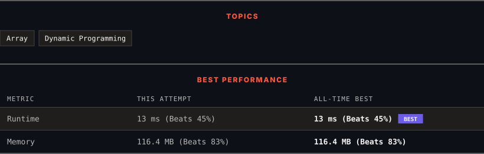

# 3693. Climbing Stairs II

      

---

<picture>
  <source media="(prefers-color-scheme: dark)" srcset="panel-dark.svg">
  <source media="(prefers-color-scheme: light)" srcset="panel-light.svg">
  
</picture>

> **New personal best** — Runtime improved on this submission.

### HOW IT WENT

| | |
|:--|:--|
| **Attempts** | first try |
| **Time to solve** | 3 min |
| **Verdicts** | ✅ Accepted |

---

### NOTES

_No notes yet._

---

### SOLUTIONS (1)

| # | File | Language | Date |
|:-:|------|:--------:|:----:|
| 1 | [sol1.java](./sol1.java) | `Java` | 2026-11-10 ← **latest** |

---

### PROBLEM DESCRIPTION

You are climbing a staircase with `n + 1` steps, numbered from 0 to `n`.

You are also given a **1-indexed** integer array `costs` of length `n`, where `costs[i]` is the cost of step `i`.

From step `i`, you can jump **only** to step `i + 1`, `i + 2`, or `i + 3`. The cost of jumping from step `i` to step `j` is defined as: `costs[j] + (j - i)^2`

You start from step 0 with `cost = 0`.

Return the **minimum** total cost to reach step `n`.

 

**Example 1:**

**Input:** n = 4, costs = [1,2,3,4]

**Output:** 13

**Explanation:**

One optimal path is `0 &rarr; 1 &rarr; 2 &rarr; 4`

	
		
			Jump
			Cost Calculation
			Cost
		
	
	
		
			0 &rarr; 1
			`costs[1] + (1 - 0)^2 = 1 + 1`
			2
		
		
			1 &rarr; 2
			`costs[2] + (2 - 1)^2 = 2 + 1`
			3
		
		
			2 &rarr; 4
			`costs[4] + (4 - 2)^2 = 4 + 4`
			8
		
	

Thus, the minimum total cost is `2 + 3 + 8 = 13`

**Example 2:**

**Input:** n = 4, costs = [5,1,6,2]

**Output:** 11

**Explanation:**

One optimal path is `0 &rarr; 2 &rarr; 4`

	
		
			Jump
			Cost Calculation
			Cost
		
	
	
		
			0 &rarr; 2
			`costs[2] + (2 - 0)^2 = 1 + 4`
			5
		
		
			2 &rarr; 4
			`costs[4] + (4 - 2)^2 = 2 + 4`
			6
		
	

Thus, the minimum total cost is `5 + 6 = 11`

**Example 3:**

**Input:** n = 3, costs = [9,8,3]

**Output:** 12

**Explanation:**

The optimal path is `0 &rarr; 3` with total cost = `costs[3] + (3 - 0)^2 = 3 + 9 = 12`

 

**Constraints:**

	- `1 <= n == costs.length <= 10^5​​​​​​​`

	- `1 <= costs[i] <= 10^4`

---

Auto-synced by <strong>LeetSync</strong> · Built by <a href="https://deveshsamant.in/">Devesh Samant</a>

