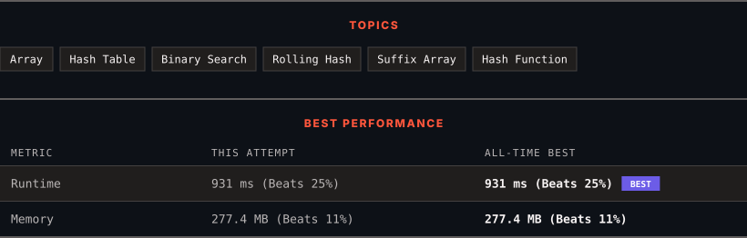

# 3934. Smallest Unique Subarray

      

---

<picture>
  <source media="(prefers-color-scheme: dark)" srcset="panel-dark.svg">
  <source media="(prefers-color-scheme: light)" srcset="panel-light.svg">
  
</picture>

> **New personal best** — Runtime improved on this submission.

### HOW IT WENT

| | |
|:--|:--|
| **Attempts** | first try |
| **Time to solve** | 1 min |
| **Verdicts** | ✅ Accepted |

---

### NOTES

_No notes yet._

---

### SOLUTIONS (1)

| # | File | Language | Date |
|:-:|------|:--------:|:----:|
| 1 | [sol1.java](./sol1.java) | `Java` | 2026-11-25 ← **latest** |

---

### PROBLEM DESCRIPTION

You are given an integer array `nums`.

Find the **minimum **length of a subarray that is **not** **identical** to any other **subarray** in `nums`.

Return an integer denoting the **minimum possible length** of such a **subarray**.

Two **subarrays** are considered identical if they have the same length and the same elements in corresponding positions.

 

**Example 1:**

**Input:** nums = [3,3,3]

**Output:** 3

**Explanation:**

	- Subarrays of length 1: `[3]` &rarr; appears 3 times

	- Subarrays of length 2: `[3, 3]` &rarr; appears 2 times

	- Subarrays of length 3: `[3, 3, 3]` &rarr; appears once

The subarray `[3, 3, 3]` is unique, so the smallest unique subarray length is 3.

**Example 2:**

**Input:** nums = [2,1,2,3,3]

**Output:** 1

**Explanation:**

Subarrays of length 1:

	- `[2]` &rarr; appears 2 times

	- `[1]` &rarr; appears once

	- `[3]` &rarr; appears 2 times

The subarray `[1]` is unique, so the smallest unique subarray length is 1.

**Example 3:**

**Input:** nums = [1,1,2,2,1]

**Output:** 2

**Explanation:**

Subarrays of length 1:

	- `[1]` &rarr; appears 3 times

	- `[2]` &rarr; appears 2 times

Subarrays of length 2:

	- `[1, 1]` &rarr; appears once

	- `[1, 2]` &rarr; appears once

	- `[2, 2]` &rarr; appears once

	- `[2, 1]` &rarr; appears once

There is at least one subarray of length 2 that is unique, so the smallest unique subarray length is 2.

 

**Constraints:**

	- `1 <= nums.length <= 10^5`

	- `1 <= nums[i] <= 10^5`

---

Auto-synced by <strong>LeetSync</strong> · Built by <a href="https://deveshsamant.in/">Devesh Samant</a>

